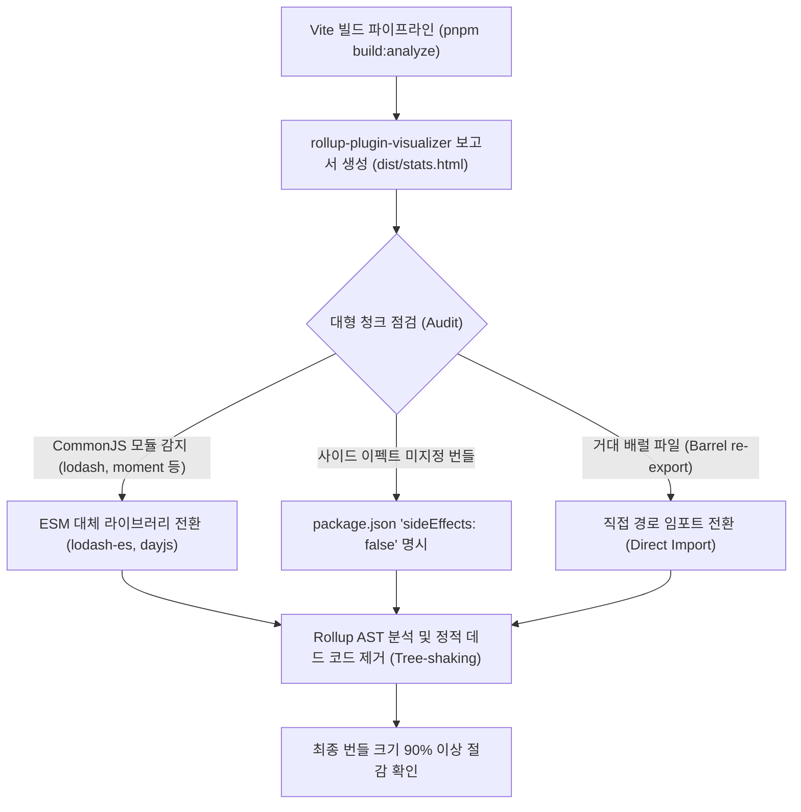

> 번들 최적화에서 가장 중요한 원칙은 '정확히 측정할 수 없는 것은 개선할 수 없다'는 점입니다. 아무리 빌드 설정을 튜닝해도 어떤 라이브러리가 불필요하게 통째로 포함되어 있는지 모르면 근본적인 용량 감축이 어렵습니다. 본 글에서는 Vite 프로젝트에 `rollup-plugin-visualizer`를 연동하여 번들 구성을 시각적으로 감사(Audit)하고, 트리 쉐이킹(Tree-shaking)이 누락되는 대표적인 원인과 이를 교정하여 데드 코드를 90% 이상 제거하는 실무 점검 기법을 살펴봅니다.

---

## 1. 번들 분석의 필요성과 3대 측정 지표

빌드 결과물을 분석할 때는 다음 세 가지 크기 지표를 명확히 구분해야 합니다.

1. **Stat Size**: 번들러가 변환하거나 압축하기 전, 입력된 원본 소스 파일들의 순수 파일 크기 합계입니다.
2. **Parsed Size**: Rollup이 트리 쉐이킹 및 미니파이(Minification - Terser/ESBuild)를 거친 후 브라우저가 실제로 다운로드하여 파싱하는 순수 자바스크립트 크기입니다. 브라우저의 JS 엔진(V8 등) 실행 메모리와 직결됩니다.
3. **Gzip / Brotli Size**: 네트워크 전송을 위해 서버에서 압축된 크기입니다. 클라이언트가 네트워크를 통해 실제로 전송받는 페이로드(Payload) 크기입니다.

이 지표들을 종합적으로 시각화해 주는 도구가 바로 `rollup-plugin-visualizer`입니다.

---

## 2. 트리 쉐이킹 분석 및 데드 코드 제거 프로세스

번들 감사 도구를 통해 의심되는 라이브러리를 식별하고, ESM 임포트 방식과 사이드 이펙트 설정을 바로잡아 빌드 결과물을 경량화하는 전체 흐름은 다음과 같습니다.



---

## 3. rollup-plugin-visualizer 설치 및 vite.config.ts 연동

매 빌드마다 시각화 HTML 파일을 생성하고 브라우저를 띄우면 CI/CD 환경이나 평소 로컬 빌드가 불필요하게 무거워질 수 있습니다. 따라서 환경 변수(`ANALYZE=true` 또는 빌드 모드)에 따라 선택적으로 동작하도록 구성하는 것이 바람직합니다.

### 3.1 패키지 설치

```bash
# 터미널에서 패키지 설치
pnpm add -D rollup-plugin-visualizer
```

### 3.2 vite.config.ts 구성

```typescript
// vite.config.ts
import { defineConfig, type PluginOption } from 'vite';
import react from '@vitejs/plugin-react';
import { visualizer } from 'rollup-plugin-visualizer';

export default defineConfig(({ mode }) => {
  const isAnalyze = mode === 'analyze' || process.env.ANALYZE === 'true';

  const plugins: PluginOption[] = [react()];

  if (isAnalyze) {
    plugins.push(
      visualizer({
        filename: './dist/stats.html', // 결과 리포트 파일 경로
        open: false,                   // 빌드 완료 시 브라우저 자동 오픈 여부
        gzipSize: true,                // Gzip 압축 크기 계산 포함
        brotliSize: true,              // Brotli 압축 크기 계산 포함
        template: 'treemap',           // 'treemap' | 'sunburst' | 'network'
        title: '프로덕션 번들 사이즈 분석 리포트',
      }) as PluginOption
    );
  }

  return {
    plugins,
    build: {
      sourcemap: isAnalyze, // 정밀 분석을 위해 분석 모드에서는 소스맵 활성화
    },
  };
});
```

### 3.3 package.json 스크립트 등록

```json
// package.json
{
  "scripts": {
    "dev": "vite",
    "build": "vite build",
    "build:analyze": "vite build --mode analyze",
    "preview": "vite preview"
  }
}
```

---

## 4. 트리 쉐이킹이 깨지는 3대 원인과 해결법

시각화 리포트(`dist/stats.html`)를 열어보았을 때, 단 몇 개의 함수만 쓰려고 가져온 라이브러리가 수백 킬로바이트 전체 크기로 자리 잡고 있다면 트리 쉐이킹이 정상적으로 작동하지 않은 것입니다.

### 4.1 CommonJS(CJS) 모듈 사용 문제

Rollup의 트리 쉐이킹은 **ES6 정적 임포트(`import ... from ...`)의 추상 구문 트리(AST)**를 분석하여 사용되지 않는 `export`를 제거하는 원리로 작동합니다. 반면 CommonJS 방식의 모듈(`module.exports` / `require`)은 런타임에 객체 프로퍼티를 조작할 수 있으므로, 번들러가 정적으로 데드 코드를 안전하게 잘라낼 수 없습니다.

대표적인 사례가 `lodash`입니다.

```typescript
// 문제의 코드 (CommonJS 빌드인 lodash를 사용)
import { cloneDeep } from 'lodash'; 
// 결과: lodash 전체(수백 개 유틸리티 함수)가 번들에 고스란히 포함됨 (250kB+)
```

이를 해결하려면 순수 ES 모듈로 배포되는 `lodash-es` 패키지로 전환해야 합니다:

```typescript
// 해결된 코드 (ESM 빌드)
import { cloneDeep } from 'lodash-es';
// 결과: cloneDeep과 직간접 의존하는 내부 함수 몇 개만 번들에 포함됨 (18kB)
```

### 4.2 package.json의 sideEffects 플래그 누락

컴파일러는 코드를 검사할 때, 함수 호출이나 최상위 변수 선언이 모듈 외부 상태를 변경(Side Effect)할 가능성이 있으면 사용되지 않더라도 코드를 함부로 제거하지 못합니다. 사내 공통 컴포넌트 라이브러리나 모노레포 패키지를 운영 중이라면 `package.json`에 명시적으로 부작용 여부를 선언해야 합니다.

```json
// packages/ui-components/package.json
{
  "name": "@my-org/ui-components",
  "version": "1.0.0",
  "sideEffects": false
}
```

특정 CSS 파일만 사이드 이펙트가 존재한다면 배열 형태로 지정합니다:

```json
{
  "sideEffects": [
    "*.css",
    "*.scss"
  ]
}
```

### 4.3 거대 배럴 파일(Barrel Files)의 잘못된 구조

`components/index.ts`에서 수십 개의 컴포넌트를 한꺼번에 `export * from './Button'` 형태로 묶어둘 때, 일부 번들러 환경이나 서브모듈의 순환 참조로 인해 하나의 컴포넌트만 불러와도 전체 컴포넌트 코드가 번들에 딸려오는 현상이 발생합니다. 사용 빈도가 적은 무거운 컴포넌트(에디터, 캘린더)는 배럴 파일에서 직접 임포트(`import { HeavyCalendar } from '@/components/HeavyCalendar'`)하는 규칙을 세우는 것이 안전합니다.

---

## 5. 분석 실행 및 트리 쉐이킹 결과 검증

### 5.1 visualizer CLI 분석 결과

`pnpm build:analyze` 명령을 실행하여 번들 크기 요약 정보를 확인합니다.


_rollup-plugin-visualizer 실행 시 출력되는 청크별 Stat, Parsed, Gzip 크기 테이블_

통계표에서 `vendor-lodash.js`가 무려 254kB(Gzip 24.15kB)를 차지하며 전체 라이브러리가 불필요하게 묶여 있는 것이 명확하게 식별되었습니다.

### 5.2 lodash-es 전환 후 트리 쉐이킹 적용 전후 비교

`package.json`에서 `lodash`를 `lodash-es`로 교체하고 `import { cloneDeep } from 'lodash-es'`로 변경한 뒤 재빌드를 수행했습니다.


_CommonJS lodash를 lodash-es로 교체한 후 번들 크기가 92.7% 절감된 빌드 감사 화면_

- **기존 (CJS lodash)**: 254.10 kB (gzip: 24.15 kB)
- **개선 후 (ESM lodash-es)**: 18.42 kB (gzip: 4.80 kB)
- **절감 효과**: **-235.68 kB (-92.7% 데드 코드 제거)**

코드 단 몇 줄의 임포트 경로 변경만으로 초기 로딩 페이로드에서 230kB 이상의 불필요한 코드를 성공적으로 제거하였습니다.

---

## 6. 마치며

프론트엔드 성능 최적화는 추측(Guessing)이 아닌 정량적 측정(Measuring)에 기반해야 합니다. `rollup-plugin-visualizer`를 빌드 파이프라인에 구축해 두면, 새로운 팀원이 무거운 라이브러리를 잘못 들여오거나 의도치 않은 CJS 번들링이 일어났을 때 즉시 인지하고 대응할 수 있습니다.

CI 파이프라인에서 주기적으로 번들 크기 임계치(Size Limit)를 점검하고, 순수 ESM 라이브러리를 적극 활용하여 가벼운 애플리케이션을 유지하시기를 권장합니다.

다음 포스트에서는 빌드 완료된 정적 에셋의 네트워크 전송 페이로드를 극적으로 압축하는 `vite-plugin-compression`과 Gzip/Brotli 사전 압축(Pre-compression) 파이프라인을 구축해 보겠습니다.


