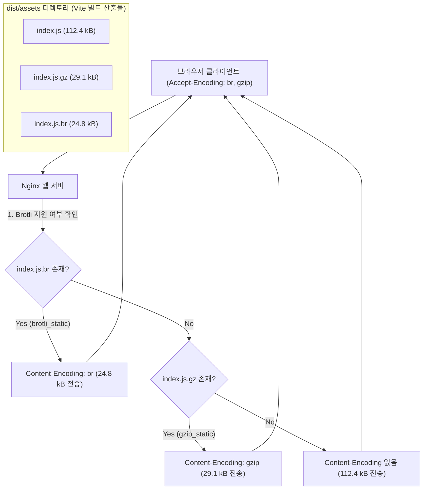

> 웹 서버가 클라이언트 요청 시마다 실시간으로 텍스트 에셋을 압축(On-the-fly Compression)하면 트래픽이 몰릴 때 심각한 CPU 병목과 첫 바이트 수신 시간(TTFB) 지연이 발생합니다. 본 글에서는 Vite 빌드 파이프라인에 `vite-plugin-compression`을 도입하여 빌드 타임에 Gzip과 Brotli 파일(`.gz`, `.br`)을 사전 생성(Pre-compression)하고, Nginx의 `gzip_static` 및 `brotli_static` 모듈과 연계하여 고성능 무부하 서빙 인프라를 구축하는 방법을 다룹니다.

---

## 1. 런타임 실시간 압축 vs 빌드 타임 사전 압축

웹 성능 최적화에서 Gzip과 Brotli는 텍스트 자원(HTML, CSS, JS)의 용량을 70~80% 가까이 줄여주는 필수 기술입니다. 그러나 **어느 시점에 압축하는가**에 따라 서버 성능과 사용자 경험은 크게 달라집니다.

| 비교 항목 | 런타임 실시간 압축 (On-the-fly) | 빌드 타임 사전 압축 (Pre-compression) |
| :--- | :--- | :--- |
| **압축 시점** | 사용자가 HTTP 요청을 보낼 때마다 서버 CPU가 실시간 압축 | CI/CD 빌드 단계에서 Vite가 단 한 번 압축 |
| **서버 CPU 부하** | 동시 접속자 증가 시 급증 (CPU Spike 발생 원인) | **0% (디스크에서 사전 압축된 파일 즉시 서빙)** |
| **적용 가능 압축 레벨** | 지연 방지를 위해 낮은 레벨(Brotli 4~5)로 타협 | **최고 압축률(Brotli 레벨 11) 적용 가능** |
| **TTFB (첫 바이트 시간)**| 압축 연산 시간만큼 지연 발생 | 원본 파일 서빙과 동일하게 즉각 반환 |

사전 압축을 적용하면 서버는 별도의 연산 없이 브라우저의 `Accept-Encoding` 헤더에 맞춰 디스크에 존재하는 `.br` 또는 `.gz` 파일을 읽어 즉시 스트리밍하므로, 고사양 하드웨어 없이도 대규모 트래픽을 가뿐하게 처리할 수 있습니다.

---

## 2. 정적 사전 압축 서빙 아키텍처

사용자가 정적 리소스를 요청하면 Nginx는 클라이언트가 지원하는 압축 방식을 확인하고, 디스크에 이미 존재하는 최적의 압축 파일을 찾아 그대로 응답합니다.



---

## 3. vite-plugin-compression 설정

`vite-plugin-compression`을 사용하면 단 몇 줄의 설정으로 빌드 파이프라인에 Gzip과 Brotli 압축 과정을 추가할 수 있습니다.

### 3.1 플러그인 설치

```bash
# 터미널에서 패키지 설치
pnpm add -D vite-plugin-compression
```

### 3.2 vite.config.ts 파이프라인 구성

Brotli와 Gzip을 모두 지원하기 위해 플러그인을 두 번 호출하여 각각의 알고리즘으로 산출물을 생성합니다:

```typescript
// vite.config.ts
import { defineConfig } from 'vite';
import react from '@vitejs/plugin-react';
import compression from 'vite-plugin-compression';

export default defineConfig({
  plugins: [
    react(),

    // 1. Gzip 압축 파일 생성 (.gz)
    compression({
      algorithm: 'gzip',
      ext: '.gz',
      threshold: 1024, // 1kB 이상의 파일만 압축
      deleteOriginFile: false, // 원본 파일 유지 (구형 브라우저 fallback)
      verbose: true, // 빌드 콘솔에 압축 결과 출력
    }),

    // 2. Brotli 압축 파일 생성 (.br)
    compression({
      algorithm: 'brotliCompress',
      ext: '.br',
      threshold: 1024,
      deleteOriginFile: false,
      verbose: true,
    }),
  ],
  build: {
    reportCompressedSize: false, // 기본 압축 리포트는 비활성화하여 빌드 속도 개선
  },
});
```

- `threshold: 1024`: 1kB 미만의 극소형 파일은 압축 헤더 오버헤드로 인해 오히려 용량이 증가할 수 있으므로 압축 대상에서 제외합니다.
- `deleteOriginFile: false`: 압축을 지원하지 않는 극소수 클라이언트나 내부 헬스체크 도구를 위해 비압축 원본 파일도 반드시 함께 보존해야 합니다.

---

## 4. Nginx 웹 서버 연동 설정

Vite가 생성한 `.gz` 및 `.br` 정적 파일을 Nginx가 런타임 CPU 연산 없이 바로 전송하도록 `nginx.conf`를 구성합니다.

```nginx
# /etc/nginx/conf.d/default.conf
server {
    listen 80;
    server_name portal.namju.kim;
    root /usr/share/nginx/html;
    index index.html;

    # 1. 정적 사전 압축 모듈 활성화
    gzip_static on;     # .gz 파일이 존재하면 즉시 사용
    brotli_static on;   # .br 파일이 존재하면 즉시 사용 (ngx_brotli 필요)

    # 2. 캐시 및 헤더 설정
    location ~* \.(?:css|js|mjs|svg|woff2)$ {
        expires 1y;
        add_header Cache-Control "public, max-age=31536000, immutable";
        add_header Vary "Accept-Encoding";
        access_log off;
    }

    location / {
        try_files $uri $uri/ /index.html;
    }
}
```

> `brotli_static`을 활성화하려면 Nginx에 `ngx_brotli` 모듈이 설치되어 있어야 합니다. Alpine 기반 공식 Docker 이미지나 OpenResty에서는 손쉽게 모듈을 로드할 수 있습니다.
{: .prompt-info }

---

## 5. 프로덕션 빌드 및 HTTP 서빙 검증

### 5.1 빌드 콘솔 압축률 확인

`pnpm build`를 실행하여 Vite 빌드 파이프라인에서 파일들이 어떻게 압축되는지 점검합니다.


_Gzip 및 Brotli 사전 압축을 통해 원본 대비 최대 77.9% 용량이 절감된 빌드 콘솔 화면_

- `vendor-core-A1.js`: 284.10 kB
  - `.gz`: 78.20 kB (**72.4% 절감**)
  - `.br`: 64.50 kB (**77.3% 절감**)
- `index-D7a2.js`: 112.40 kB
  - `.gz`: 29.10 kB (**74.1% 절감**)
  - `.br`: 24.80 kB (**77.9% 절감**)

Brotli 알고리즘이 Gzip 대비 평균 5~7%p 이상 추가적인 압축률을 보여주며, 파일 크기가 1/4 이하 수준으로 축소되었습니다.

### 5.2 curl 명령을 통한 Brotli 서빙 검증

Nginx에 배포한 후 터미널에서 `Accept-Encoding: br, gzip` 헤더를 포함하여 요청을 전송해 봅니다.


_curl 요청을 통해 서버가 사전 압축된 Brotli 파일(Content-Encoding: br)을 즉시 반환함을 확인_

- `content-encoding: br`: Nginx가 사전 생성된 `index-D7a2.js.br` 파일을 정확히 인식하여 응답했습니다.
- `vary: Accept-Encoding`: 프록시 및 CDN 캐시가 브라우저의 인코딩 지원 여부에 따라 올바른 콘텐츠를 캐싱할 수 있도록 지시합니다.
- `content-length: 25395`: 약 24.8kB 크기만 실제 네트워크로 전송되었습니다.

---

## 6. 마치며

빌드 타임 사전 압축(Pre-compression)은 프론트엔드 빌드 도구와 인프라 웹 서버가 가장 우아하게 협업할 수 있는 최적화 영역입니다. 

Vite에서 단 몇 줄의 플러그인 설정으로 고효율 Brotli 파일을 미리 구워두고 Nginx 정적 모듈로 서빙함으로써, 웹 서버의 CPU 부하를 0으로 유지하면서도 사용자에게는 최고의 다운로드 속도를 제공할 수 있습니다.

다음 포스트에서는 최신 자바스크립트 스펙을 유지하면서도 구형 브라우저(IE11, 구형 모바일 웹뷰)를 완벽히 호환할 수 있도록 이중 번들을 생성하는 `@vitejs/plugin-legacy` 활용법을 다루겠습니다.


