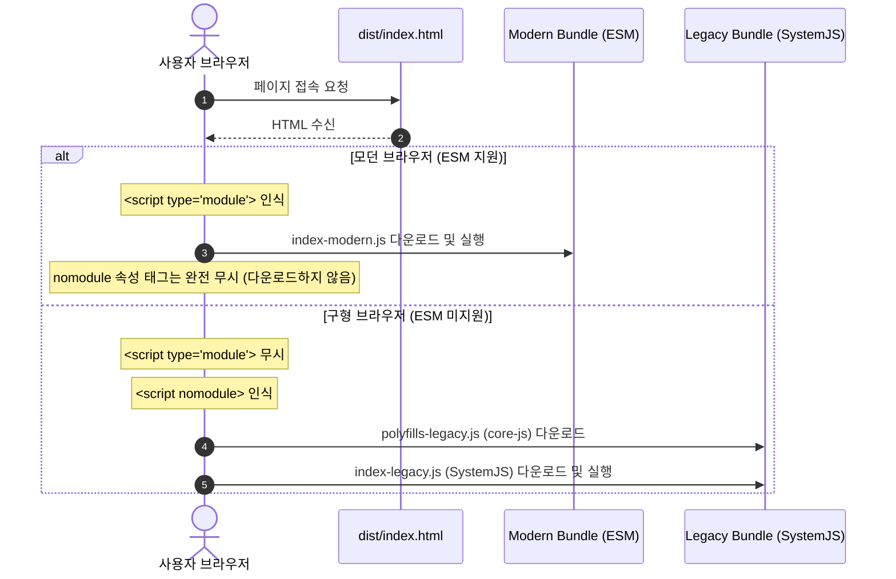

> Vite는 기본적으로 네이티브 ES 모듈(ESM)을 지원하는 최신 브라우저 환경을 타깃으로 빌드되므로 매우 가볍고 빠릅니다. 그러나 엔터프라이즈 사내 시스템이나 특정 안드로이드 구형 인앱 브라우저(WebView)를 지원해야 하는 경우, 전체 번들에 무거운 Babel 트랜스파일과 폴리필을 강제하면 대다수의 모던 브라우저 사용자에게 불필요한 용량 페널티를 주게 됩니다. 본 글에서는 `@vitejs/plugin-legacy`를 활용하여 모던 환경과 레거시 환경을 완전히 분리하는 차등 서빙(Differential Serving) 파이프라인을 구축해 봅니다.

---

## 1. 모던 우선(Modern-first) 정책과 하위 호환성 딜레마

Vite의 기본 빌드 타깃(`build.target: 'modules'`)은 다음 이상의 모던 브라우저를 전제로 합니다.

- Chrome 87+
- Firefox 78+
- Safari 14+
- Edge 88+

하지만 구형 안드로이드 기기나 POS 단말기, 사내 폐쇄망 환경에서는 구형 브라우저 호환성이 필수적일 때가 있습니다. 만약 Webpack 시절처럼 모든 사용자를 위해 전체 소스 코드를 ES5로 다운컴파일하고 `core-js` 폴리필 수십 킬로바이트를 번들 전면에 강제 주입하면 다음과 같은 문제가 발생합니다.

1. **모던 브라우저 성능 희생**: 95% 이상의 대다수 모던 브라우저 사용자가 불필요한 폴리필과 복잡한 ES5 헬퍼 함수를 다운로드하고 파싱해야 합니다.
2. **번들 용량 급증**: 번들 크기가 기본 50~100kB 이상 증가하여 초기 로딩(FCP)이 지연됩니다.

이를 해결하기 위해 Vite는 W3C 표준인 **`<script type="module">`**과 **`<script nomodule>`**을 이용한 **차등 서빙(Differential Serving)** 아키텍처를 공식 지원합니다.

---

## 2. 차등 서빙(Differential Serving) 듀얼 번들 로딩 시퀀스

브라우저는 자신의 표준 지원 여부에 따라 실행할 스크립트 태그를 스스로 결정합니다.



이 구조를 사용하면 구형 브라우저에서만 추가적인 폴리필과 트랜스파일 코드가 로드되며, 최신 브라우저는 아무런 오버헤드 없이 초경량 네이티브 ESM 코드를 그대로 실행합니다.

---

## 3. @vitejs/plugin-legacy 설치 및 vite.config.ts 설정

Vite 공식 레거시 플러그인을 설치하여 이중 빌드 파이프라인을 구성합니다.

### 3.1 패키지 설치

```bash
# 터미널에서 패키지 설치
pnpm add -D @vitejs/plugin-legacy
pnpm add -D terser # 레거시 청크의 안전한 최소화를 위해 terser 설치 권장
```

### 3.2 vite.config.ts 구성

```typescript
// vite.config.ts
import { defineConfig } from 'vite';
import react from '@vitejs/plugin-react';
import legacy from '@vitejs/plugin-legacy';

export default defineConfig({
  plugins: [
    react(),
    legacy({
      // 1. 지원 대상 브라우저 범위 (Browserslist 쿼리)
      targets: ['defaults', 'not IE 11', 'chrome >= 64', 'ios >= 12'],

      // 2. 구형 브라우저에 주입할 명시적 폴리필 목록
      polyfills: [
        'es.promise.finally',
        'es.array.flat-map',
        'es.object.from-entries',
      ],

      // 3. 모던 브라우저용 추가 폴리필 (필요한 경우에만)
      modernPolyfills: false,

      // 4. 모던 청크도 레거시 플러그인 변환 대상에 포함할지 여부
      renderModernChunks: true,
    }),
  ],
  build: {
    // legacy 플러그인을 사용할 때는 rollup target을 es2020 등으로 설정 유지
    target: 'es2020',
  },
});
```

- `targets`: 프로젝트가 타깃으로 삼는 구형 브라우저의 마지노선을 Browserslist 문법으로 지정합니다.
- `modernPolyfills: false`: 최신 브라우저에는 어떠한 폴리필도 주입하지 않아 번들 크기를 극도로 가볍게 유지합니다.
- `renderModernChunks: true`: 모던 청크에서도 `<script type="module">` 래핑과 최적화를 온전히 유지합니다.

---

## 4. Safari 10 nomodule 버그 우회 처리

Safari 10.1 등 일부 초기 브라우저는 `type="module"`을 지원하면서도 `nomodule` 속성을 인식하지 못해 **모던 번들과 레거시 번들을 동시에 다운로드**하는 유명한 버그가 있었습니다.

`@vitejs/plugin-legacy`는 이 문제를 방지하기 위해 `index.html` 내부에 아래와 같은 인라인 픽스 스크립트를 자동으로 삽입해 줍니다:

```html
<script nomodule>
  !function(){
    var e=document,t=e.createElement("script");
    if(!("noModule"in t)&&"onbeforeload"in t){
      var n=!1;
      e.addEventListener("beforeload",function(e){
        if(e.target===t)n=!0;else if(!e.target.hasAttribute("nomodule")||!n)return;
        e.preventDefault()
      },!0);
      t.type="module";t.src=".";e.head.appendChild(t);t.remove()
    }
  }();
</script>
```

개발자가 복잡한 브라우저 버그 핵(Hack)을 직접 고민할 필요 없이, 플러그인이 표준에 부합하는 안전한 폴백 환경을 완성해 줍니다.

---

## 5. 빌드 및 산출물 HTML 검증

### 5.1 듀얼 번들 빌드 터미널 출력 확인

`pnpm build`를 실행하면 Vite가 1단계로 모던 번들을 빌드하고, 2단계로 레거시 번들을 연속 생성하는 모습을 볼 수 있습니다.


_Modern 번들과 Legacy 번들 및 core-js polyfill 번들이 분리 생성된 터미널 화면_

- **Modern 번들 (`index-modern-B2c.js`)**: 124.50 kB (gzip: 38.10 kB)
- **Legacy 번들 (`index-legacy-D9a.js`)**: 168.40 kB (gzip: 49.30 kB)
- **Legacy 폴리필 (`polyfills-legacy-A8f.js`)**: 68.20 kB (gzip: 22.40 kB)

모던 브라우저는 오직 124kB의 깨끗한 ESM 코드만 수신하며, 구형 브라우저만 추가 68kB의 폴리필과 ES5 트랜스파일 코드를 로드하게 됩니다.

### 5.2 dist/index.html 스크립트 태그 검증

빌드된 `dist/index.html`의 스크립트 주입 결과를 확인합니다.


_type="module"과 nomodule 태그가 완벽히 분리 배치된 dist/index.html 확인 화면_

- `<head>` 영역: `<script type="module" crossorigin src="/assets/index-modern-B2c.js"></script>`
- `<body>` 하단: `<script nomodule ... src="/assets/polyfills-legacy-A8f.js"></script>` 및 SystemJS 로더 기반의 `<script nomodule ... src="/assets/index-legacy-D9a.js">`

현대 브라우저는 하단의 `nomodule` 블록을 완벽하게 무시하고 헤드의 모던 자바스크립트를 즉시 실행합니다.

---

## 6. 마치며

구형 브라우저 지원은 웹 엔지니어링에서 늘 무거운 짐으로 여겨져 왔습니다. 하지만 `@vitejs/plugin-legacy`의 차등 서빙 기법을 적용하면, 기존 고객의 호환성을 보장하면서도 최신 브라우저를 사용하는 대다수 사용자에게 최고의 성능과 경량 번들을 온전히 제공할 수 있습니다.

사내 웹뷰나 레거시 디바이스 대응이 불가피하다면, 전체 프로젝트를 무리하게 ES5로 회귀시키지 말고 차등 서빙 파이프라인을 도입해 보시기를 적극 권장합니다.

다음 포스트에서는 빌드 타임에 이미지 에셋(PNG, JPEG, SVG)을 WebP 및 AVIF 차세대 포맷으로 자동 변환하고 무손실 압축하는 `vite-plugin-image-optimizer` 파이프라인을 구성해 보겠습니다.


