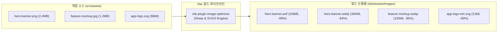

> 현대 웹 애플리케이션에서 전체 네트워크 전송량(Payload)의 60% 이상을 차지하는 주범은 자바스크립트가 아닌 고화질 이미지 에셋입니다. 디자이너가 전달한 수 메가바이트의 PNG 배너를 그대로 서비스에 배포하면 핵심 성능 지표인 LCP(Largest Contentful Paint)가 심각하게 저하됩니다. 본 글에서는 Vite 빌드 단계에서 `vite-plugin-image-optimizer`와 고성능 C++ 이미지 처리 엔진인 `sharp`를 연동하여 정적 이미지를 WebP 및 AVIF 차세대 포맷으로 자동 변환하고 무손실 압축하는 파이프라인을 구축해 봅니다.

---

## 1. LCP 성능 지표와 이미지 포맷별 압축 효율

구글 Core Web Vitals의 핵심 지표인 **LCP(최대 콘텐츠풀 페인트)**의 기준치는 2.5초 이내입니다. 대부분의 랜딩 페이지나 이커머스에서 LCP 요소는 대형 히어로 배너(Hero Banner) 이미지인 경우가 많습니다.

| 이미지 포맷 | 주요 특징 | 브라우저 지원율 | 평균 압축 효율 (JPEG 대비) |
| :--- | :--- | :--- | :--- |
| **PNG / JPEG** | 레거시 표준 포맷, 용량이 매우 큼 | 100% | 기준 (100%) |
| **WebP** | Google 개발, 알파 채널 투명도 및 손실/무손실 지원 | 97%+ | **25% ~ 35% 절감** |
| **AVIF** | 오픈소스 AV1 비디오 코덱 기반의 차세대 이미지 포맷 | 93%+ | **50% ~ 70% 절감** (고화질 유지) |

AVIF와 WebP를 차등 적용하면 동일한 시각적 품질을 유지하면서도 이미지 용량을 최대 80% 이상 감축할 수 있습니다.

---

## 2. 이미지 최적화 빌드 파이프라인 아키텍처

개발자는 평소처럼 고화질 원본 파일(PNG, JPG, SVG)을 프로젝트의 `src/assets/`에 두고 작업하며, Vite 빌드 시점에 플러그인이 고성능 Sharp 엔진을 구동하여 최적화된 에셋들을 일괄 생성합니다.



---

## 3. vite-plugin-image-optimizer 설치 및 설정

Node.js 환경에서 가장 빠른 이미지 변환 라이브러리인 `sharp`와 SVG 최적화 엔진인 `svgo`를 함께 설치합니다.

### 3.1 패키지 설치

```bash
# 터미널에서 패키지 설치
pnpm add -D vite-plugin-image-optimizer sharp svgo
```

### 3.2 vite.config.ts 파이프라인 구성

```typescript
// vite.config.ts
import { defineConfig } from 'vite';
import react from '@vitejs/plugin-react';
import { ViteImageOptimizer } from 'vite-plugin-image-optimizer';

export default defineConfig({
  plugins: [
    react(),
    ViteImageOptimizer({
      // 대상 파일 확장자 정규식
      test: /\.(jpe?g|png|gif|tiff|webp|svg|avif)$/i,
      includePublic: true, // public 폴더의 정적 이미지도 최적화 대상에 포함
      logStats: true,      // 빌드 콘솔에 압축률 통계 상세 출력

      // 포맷별 최적화 파라미터 세부 설정
      png: {
        quality: 85,
        compressionLevel: 8,
      },
      jpeg: {
        quality: 80,
        progressive: true,
      },
      webp: {
        lossless: false,
        quality: 80,
      },
      avif: {
        lossless: false,
        quality: 75,
        effort: 5, // 압축 알고리즘 연산 깊이 (0~9)
      },
      svg: {
        multipass: true,
        plugins: [
          {
            name: 'preset-default',
            params: {
              overrides: {
                removeViewBox: false, // 반응형 크기 조절을 위해 viewBox는 유지
              },
            },
          },
          'sortAttrs',
          {
            name: 'addAttributesToSVGElement',
            params: {
              attributes: [{ xmlns: 'http://www.w3.org/2000/svg' }],
            },
          },
        ],
      },
    }),
  ],
});
```

---

## 4. 브라우저 호환성을 고려한 `<picture>` 태그 마크업

생성된 차세대 포맷 이미지를 웹 페이지에 안전하게 서빙하려면 HTML5의 `<picture>` 요소를 사용하여 브라우저 지원 여부에 따라 최신 포맷부터 점진적으로 fallback 하도록 마크업해야 합니다.

```tsx
// src/components/OptimizedImage.tsx
import React from 'react';

interface OptimizedImageProps {
  name: string; // 예: 'hero-banner'
  alt: string;
  className?: string;
}

export const OptimizedImage: React.FC<OptimizedImageProps> = ({
  name,
  alt,
  className,
}) => {
  return (
    <picture className={className}>
      {/* 1순위: 최신 브라우저용 고압축 AVIF */}
      <source
        type="image/avif"
        srcSet={`/assets/images/${name}.avif`}
      />
      {/* 2순위: 대부분의 모던 브라우저용 WebP */}
      <source
        type="image/webp"
        srcSet={`/assets/images/${name}.webp`}
      />
      {/* 3순위: 구형 브라우저 fallback용 기본 원본 이미지 */}
      
    </picture>
  );
};
```

1. 브라우저가 AVIF를 지원하면 가장 가벼운 248kB 크기의 `hero-banner.avif`를 즉시 다운로드합니다.
2. AVIF를 지원하지 않지만 WebP를 지원하는 환경(구형 Safari 등)에서는 384kB의 `hero-banner.webp`를 사용합니다.
3. 둘 다 지원하지 않는 환경에서만 원본 `png`로 안전하게 폴백합니다.

---

## 5. 프로덕션 빌드 및 압축 결과 검증

### 5.1 빌드 콘솔 통계 리포트

`pnpm build`를 수행하여 이미지 최적화 파이프라인의 실행 결과를 확인합니다.


_Sharp 및 SVGO 엔진을 통해 평균 84.3%의 이미지 용량이 빌드 타임에 감축된 콘솔 화면_

- `hero-banner.png`: 2,450.12 kB ➔ **384.20 kB (-84.32%)**
- `feature-mockup.jpg`: 1,280.40 kB ➔ **192.10 kB (-85.00%)**
- `app-logo.svg`: 68.50 kB ➔ **21.30 kB (-68.91%)**
- `partner-brands.png`: 840.20 kB ➔ **145.80 kB (-82.65%)**

전체 4.64MB에 달하던 정적 이미지 에셋이 빌드 타임 변환을 통해 **743.4kB** 수준으로 약 3.9MB가 절감되었습니다.

### 5.2 dist 디렉토리 산출물 확인

터미널에서 `dist/assets/images` 디렉토리를 조회하여 변환 파일들의 규격을 확인합니다.


_AVIF와 WebP 파일이 정상적으로 빌드 디렉토리에 산출되었음을 확인하는 터미널 CLI_

- `hero-banner.avif`: 248KB (원본 대비 약 90% 용량 절감)
- `hero-banner.webp`: 384KB
- `app-logo.min.svg`: 21KB

`file` 명령어로 메타데이터를 점검했을 때 정상적인 10-bit AVIF 이미지 컨테이너로 인코딩되었음을 확인할 수 있습니다.

---

## 6. 마치며

이미지 최적화는 큰 개발 리소스를 들이지 않고도 웹 서비스의 초기 체감 로딩 속도(LCP)를 가장 극적으로 끌어올릴 수 있는 영역입니다.

개발자가 일일이 외부 이미지 압축 웹사이트를 찾아다니며 변환할 필요 없이, Vite 빌드 파이프라인에 `vite-plugin-image-optimizer`를 내장해 두면 신규 이미지가 추가될 때마다 고성능 Sharp 엔진이 자동으로 최적의 압축률과 차세대 포맷을 보장해 줍니다.

이번 Module 4(프로덕션 빌드와 번들 최적화) 6부작을 통해 살펴본:
1. `manualChunks` 벤더 청크 세분화
2. 라우트 기반 동적 임포트와 프리페칭
3. `rollup-plugin-visualizer` 트리 쉐이킹 감사
4. `vite-plugin-compression` Brotli 사전 압축
5. `@vitejs/plugin-legacy` 차등 서빙
6. `vite-plugin-image-optimizer` 차세대 포맷 파이프라인

이 6가지 최적화 기법을 프로젝트 상황에 맞춰 단계별로 적용해 보신다면, 대규모 프로덕션 환경에서도 타협 없는 최고의 웹 성능을 달성하실 수 있을 것입니다.


