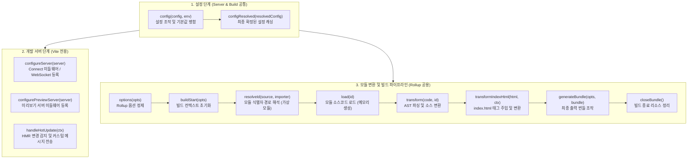

> Vite는 개발 환경의 초고속 번들링리스 아키텍처와 프로덕션 환경의 고도화된 Rollup 빌드 파이프라인을 단일 플러그인 인터페이스로 매끄럽게 연결합니다. 본 글에서는 Vite 플러그인을 구성하는 Rollup 공용 훅(Universal Hooks)과 Vite 전용 훅의 생명주기(Lifecycle)를 상세히 분석하고, 훅의 실행 흐름을 추적·프로파일링하는 커스텀 플러그인을 직접 구현해 봅니다.

---

## 1. 배경: Vite와 Rollup의 하이브리드 아키텍처

Vite의 뛰어난 개발자 경험(DX)은 로컬 개발 환경과 프로덕션 빌드 환경의 역할을 전략적으로 분리한 구조에서 출발합니다. 로컬 개발 환경에서는 네이티브 ES Modules(ESM)와 Go 기반의 esbuild를 활용해 사전 번들링 및 온디맨드(On-demand) 파일 서빙을 수행하고, 프로덕션 빌드 환경에서는 검증된 Rollup 번들러를 통해 안정적인 청크 분할과 트리 쉐이킹(Tree-shaking)을 수행합니다.

이러한 이원화 구조에서 개발자가 환경마다 별도의 플러그인을 작성해야 한다면 DX가 크게 저하될 수밖에 없습니다. Vite 팀은 이를 해결하기 위해 **Rollup의 플러그인 인터페이스를 확장한 범용 플러그인 아키텍처**를 설계했습니다.

따라서 대부분의 Rollup 플러그인은 코드 수정 없이 Vite에서도 즉시 호환되며, Vite 플러그인은 Rollup의 번들링 훅뿐만 아니라 개발 서버(Connect 미들웨어, WebSocket HMR)를 직접 제어할 수 있는 고유 훅을 추가로 활용할 수 있습니다.

---

## 2. Vite 플러그인 생명주기 훅 분류

Vite 플러그인은 객체 또는 객체를 반환하는 팩토리 함수로 작성되며, 훅(Hooks)은 호출되는 시점과 목적에 따라 크게 세 가지 그룹으로 분류됩니다.



### 2.1 서버 및 설정 훅 (Configuration Hooks)
- `config(config, env)`: 사용자가 작성한 `vite.config.ts` 설정을 읽고, 조건부로 설정을 재정의하거나 누락된 기본값을 병합할 때 사용합니다.
- `configResolved(resolvedConfig)`: 플러그인 체인의 모든 `config` 훅이 완료된 후 최종적으로 동결된 Vite 설정 객체를 전달받아 참조를 보관할 때 사용합니다.
- `configureServer(server)`: Vite 개발 서버 인스턴스(`ViteDevServer`)에 접근하여 Connect 미들웨어를 등록하거나 웹소켓 채널을 확장합니다.
- `handleHotUpdate(ctx)`: 파일 변경 이벤트 발생 시 HMR(Hot Module Replacement) 파이프라인에 직접 개입하여 업데이트할 모듈 목록을 필터링하거나 브라우저로 커스텀 이벤트를 발송합니다.

### 2.2 빌드 및 변환 훅 (Rollup Universal Hooks)
개발 서버 요청 처리 시와 프로덕션 `vite build` 시 모두 동일하게 실행되는 공용 훅입니다.
- `resolveId(source, importer)`: 모듈 식별자(`import 'foo'`)를 실제 파일 시스템 경로 또는 가상 모듈 ID로 변환합니다.
- `load(id)`: 해석된 모듈 ID에 대한 실제 소스코드를 반환합니다.
- `transform(code, id)`: 로드된 개별 모듈의 소스코드를 트랜스파일하거나 변형합니다.
- `transformIndexHtml(html, ctx)`: 애플리케이션 진입점인 `index.html`을 파싱하여 스크립트, 스타일시트, 메타 태그를 동적으로 주입합니다.

---

## 3. 플러그인 실행 순서 제어: enforce와 apply

Vite는 플러그인들의 실행 순서와 실행 환경을 정밀하게 제어할 수 있도록 두 가지 주요 속성을 제공합니다.

### 3.1 enforce: 플러그인 정렬 순서
Vite 내부 플러그인과 서드파티 플러그인 사이의 실행 우선순위를 결정합니다.

```typescript
// plugins/types.ts
export interface Plugin {
  name: string;
  enforce?: 'pre' | 'post';
  // ...
}
```

1. **Alias 플러그인**: 경로 별칭 해석
2. **`enforce: 'pre'` 플러그인**: Vite 핵심 플러그인보다 먼저 실행 (ESLint, 코드 생성기 등)
3. **Vite 내부 코어 플러그인**: 내장 변환 파이프라인
4. **일반 플러그인 (`enforce` 미지정)**: 일반적인 커스텀 플러그인
5. **Vite 빌드 플러그인**: 프로덕션 빌드 전용 최적화
6. **`enforce: 'post'` 플러그인**: Vite 빌드 최적화 이후 실행 (번들 분석기, 사후 압축 등)

### 3.2 apply: 실행 환경 분기
플러그인이 특정 모드에서만 동작하도록 한정할 수 있습니다.

```typescript
// 개발 서버(vite)에서만 동작
apply: 'serve'

// 프로덕션 빌드(vite build)에서만 동작
apply: 'build'

// 또는 조건부 함수 형태
apply(config, { command, mode }) {
  return command === 'build' && mode === 'production';
}
```

---

## 4. 실습: 생명주기 훅 추적 플러그인 구현

Vite가 실제로 어떤 순서로 훅을 호출하고 모듈을 요청 시점에 변환하는지 직접 확인하기 위해, 모든 주요 훅의 실행 타임스탬프와 소요 시간을 콘솔에 출력하는 `lifecycleTracerPlugin`을 작성해 보겠습니다.

```typescript
// plugins/vite-plugin-lifecycle-tracer.ts
import type { Plugin, ResolvedConfig, ViteDevServer } from 'vite';

interface TracerOptions {
  verbose?: boolean;
}

export function lifecycleTracerPlugin(options: TracerOptions = {}): Plugin {
  let resolvedConfig: ResolvedConfig;
  const startTime = Date.now();

  const log = (hookName: string, detail: string) => {
    const elapsed = Date.now() - startTime;
    const timeStr = new Date().toTimeString().split(' ')[0] + '.' + String(elapsed % 1000).padStart(3, '0');
    console.log(`\x1b[90m[${timeStr}]\x1b[0m \x1b[34m[${hookName}]\x1b[0m ${detail}`);
  };

  return {
    name: 'vite-plugin-lifecycle-tracer',
    enforce: 'pre',

    // 1. 설정 단계 훅
    config(userConfig, env) {
      log('config', `Hook triggered (mode: ${env.mode}, command: ${env.command})`);
      return {
        define: {
          __LIFECYCLE_DEBUG__: true,
        },
      };
    },

    configResolved(config) {
      resolvedConfig = config;
      log('configResolved', `Config finalized (root: ${config.root}, mode: ${config.mode})`);
    },

    // 2. 개발 서버 전용 훅
    configureServer(server: ViteDevServer) {
      log('configureServer', 'HTTP DevServer & Connect middleware attached');

      // 미들웨어 체인 완료 후 시점 로깅
      server.httpServer?.once('listening', () => {
        log('server:ready', `Dev server listening (base: ${resolvedConfig.base})`);
      });
    },

    handleHotUpdate(ctx) {
      log('handleHotUpdate', `File changed: ${ctx.file} (${ctx.modules.length} modules affected)`);
      return ctx.modules;
    },

    // 3. Rollup 공용 빌드 훅
    options(rollupOptions) {
      log('options', `Rollup options received (input: ${JSON.stringify(rollupOptions.input || 'index.html')})`);
      return rollupOptions;
    },

    buildStart(options) {
      log('buildStart', 'Build context initialized');
    },

    resolveId(source, importer) {
      if (source.startsWith('/src/main') || source === 'index.html') {
        log('resolveId', `Resolving ${source} from ${importer || 'entry'}`);
      }
      return null; // 기본 해석 로직에 위임
    },

    load(id) {
      if (id.includes('/src/main.ts')) {
        log('load', `Loading module source: ${id}`);
      }
      return null; // 기본 파일 로더에 위임
    },

    transform(code, id) {
      if (id.includes('/src/main.ts')) {
        log('transform', `Transforming ${id} (${code.length} bytes)`);
      }
      return null;
    },

    transformIndexHtml(html) {
      log('transformIndexHtml', 'Injecting metadata into index.html');
      return html;
    },

    buildEnd() {
      log('buildEnd', 'Build phase completed');
    },

    closeBundle() {
      log('closeBundle', 'Output bundle written successfully');
    },
  };
}
```

이제 `vite.config.ts`에 플러그인을 등록합니다.

```typescript
// vite.config.ts
import { defineConfig } from 'vite';
import { lifecycleTracerPlugin } from './plugins/vite-plugin-lifecycle-tracer';

export default defineConfig({
  plugins: [
    lifecycleTracerPlugin({ verbose: true }),
  ],
});
```

---

## 5. 실행 결과 및 환경별 훅 동작 차이 분석

### 5.1 개발 서버(`npm run dev`)에서의 실행 순서

개발 서버 구동 시에는 모든 파일이 사전에 번들링되지 않고, 브라우저가 첫 요청을 보낼 때 비로소 `resolveId` -> `load` -> `transform` 훅이 온디맨드로 실행됩니다.


1. 서버가 뜨기 전 `config` -> `configResolved` -> `options` -> `configureServer` -> `buildStart` 순서로 초기 설정이 완료됩니다.
2. 브라우저가 `http://localhost:5173/`에 접속하면 `index.html` 서빙 시 `transformIndexHtml`이 실행됩니다.
3. 브라우저가 `<script type="module" src="/src/main.ts">`를 요청하면, 해당 파일에 한하여 `resolveId` -> `load` -> `transform`이 즉시 처리됩니다.
4. 파일 수정 시 전체 다시 빌드가 발생하지 않고 `handleHotUpdate` 훅이 발동하여 변경된 모듈만 클라이언트로 푸시됩니다.

### 5.2 프로덕션 빌드(`npm run build`)에서의 실행 순서

반면 프로덕션 빌드 환경에서는 전체 모듈 그래프를 순회하며 Rollup 번들링 파이프라인이 정적으로 완료될 때까지 모든 훅이 차례대로 진행됩니다.


- 빌드 초기화 후 엔트리포인트부터 연결된 모든 파일에 대해 `resolveId`, `load`, `transform`이 일괄 수행됩니다.
- 모듈 변환이 끝나면 `renderChunk`, `generateBundle`을 거쳐 물리적 디스크 디렉토리(`dist/`)에 파일이 생성됩니다.
- 최종적으로 `closeBundle` 훅이 호출되면서 빌드 프로세스가 안전하게 종료됩니다.

---

## 6. 실무 적용 시 고려사항

1. **상태 공유의 스코프 격리**:
   플러그인 객체 내부의 변수에 상태를 저장할 때는 개발 서버의 지속적인 재요청과 HMR 환경에서도 데이터 정합성이 깨지지 않도록 유의해야 합니다.
2. **비동기 훅의 블로킹 제어**:
   `config`나 `buildStart`와 같은 초기화 훅에서 무거운 비동기 I/O 작업을 수행하면 전체 개발 서버 기동 속도가 지연되므로, 무거운 작업은 백그라운드 워커나 온디맨드 훅(`load`, `transform`)으로 이관하는 것이 바람직합니다.
3. **Rollup 플러그인 컨텍스트(`this`) 활용**:
   훅 내부에서는 `this.emitFile()`, `this.warn()`, `this.error()`와 같은 Rollup 유틸리티 메서드를 직접 사용할 수 있어 표준 로깅 및 애셋 생성이 용이합니다.

---

## 7. Vite 7(Rollup)에서 Vite 8(Rolldown)으로의 생명주기 훅 진화

Vite 8로 전환되면서 가장 핵심적인 변화는 프로덕션 빌더가 JavaScript 기반 Rollup에서 **Rust 기반 초고속 번들러인 Rolldown**으로 전격 교체된다는 점입니다.

- **완벽한 플러그인 API 드롭인 호환**:
  - Rolldown은 Rollup의 표준 플러그인 인터페이스를 100% 준수하도록 설계되었습니다. 따라서 본 글에서 구현한 `resolveId`, `load`, `transform`, `buildStart`, `closeBundle` 등의 훅은 **코드 수정 없이 Vite 8 Rolldown 환경에서도 그대로 동작**합니다.
- **Vite 7 (하이브리드 과도기)**:
  - 기본적으로는 Rollup을 통해 생명주기 훅이 실행되며, `build: { rolldown: true }` 실험적 플래그를 통해 Rolldown 파이프라인과의 플러그인 호환성을 사전에 검증할 수 있습니다.
- **Vite 8 (Rolldown Rust 멀티스레드 파이프라인)**:
  - Rust Oxc 파서와 멀티스레드 런타임에 의해 `resolveId`와 `load`가 병렬로 처리됩니다.
  - 주의점: JavaScript로 작성된 커스텀 훅이 Rust 코어와 빈번하게 통신할 경우 Node.js FFI 브릿지 오버헤드가 발생할 수 있으므로, `transform` 훅 내부에서 정규식이나 확장자 필터(`include`/`exclude`)를 사전에 엄격히 적용하여 대상 파일만 가로채는 최적화가 더욱 중요해집니다.

---

## 8. 마치며

Vite 플러그인의 생명주기 구조는 빠른 개발 서버의 이점과 견고한 프로덕션 번들 파이프라인의 완성도를 모두 충족할 수 있도록 정교하게 설계되어 있습니다.

특히 Rollup의 검증된 훅 규격을 기반으로 설계된 덕분에, 향후 Vite 8의 Rolldown 단일 통합 번들러 환경에서도 작성한 플러그인을 그대로 재사용하며 10배 이상의 네이티브 속도 향상을 온전히 누릴 수 있습니다.

다음 포스트에서는 파일시스템에 없는 모듈을 런타임에 인메모리로 합성하여 애플리케이션에 주입하는 **가상 모듈(Virtual Module)** 패턴을 상세히 다루겠습니다.
