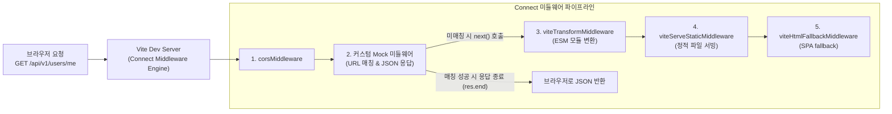

> 백엔드 API 명세가 확정되었지만 구현이 완료되지 않은 초기 개발 단계에서, 별도의 모킹 서버를 띄우거나 브라우저 서비스 워커를 구성하는 일은 프로젝트 설정의 복잡도를 높입니다. 본 글에서는 Vite 개발 서버의 `configureServer` 훅과 Connect 미들웨어 파이프라인을 활용하여, 단일 개발 서버 프로세스 안에서 CORS 없이 지연 시간과 상태 코드를 제어하는 무서버(Serverless) Mock API 플러그인을 직접 구현해 봅니다.

---

## 1. 배경: 프론트엔드 Mocking 아키텍처 비교

프론트엔드 프로젝트를 진행하다 보면 백엔드 API 개발 일정과의 격차로 인해 모킹(Mocking) 솔루션이 반드시 필요해집니다. 흔히 쓰이는 방식들은 각각 장단점을 지니고 있습니다.

1. **독립된 백엔드 Mock 서버 (Express, json-server, NestJS)**:
   - 별도 프로세스를 실행해야 하므로 터미널 세션이 늘어나고 포트 충돌 위험이 있습니다.
   - 로컬 개발 환경에서 CORS(Cross-Origin Resource Sharing) 문제를 해결하기 위해 Vite 프록시 설정을 추가해야 합니다.
2. **서비스 워커 기반 Mocking (MSW - Mock Service Worker)**:
   - 브라우저 레벨에서 네트워크 요청을 가로채므로 실제 서버와 동일하게 동작합니다.
   - 단, `mockServiceWorker.js` 정적 에셋을 `public` 폴더에 복사해야 하고, Service Worker의 수명 주기 및 브라우저 캐시 이슈를 관리해야 합니다.
3. **Vite 개발 서버 내부 Connect 미들웨어**:
   - 프론트엔드 개발 서버(`http://localhost:5173`)와 동일한 호스트/포트를 공유하므로 **CORS 문제가 원천적으로 발생하지 않습니다.**
   - 별도 프로세스나 브라우저 워커 등록 없이 `npm run dev` 명령 하나로 즉시 동작합니다.
   - 필요 시 `apply: 'serve'` 설정을 통해 프로덕션 빌드 번들에 1바이트의 오염도 남기지 않습니다.

---

## 2. Vite의 Connect 미들웨어 아키텍처

Vite의 개발 서버(`ViteDevServer`)는 내부적으로 Node.js 진영의 고전적이면서도 경량화된 HTTP 미들웨어 프레임워크인 **Connect**를 기반으로 작동합니다.



Vite 플러그인의 `configureServer(server)` 훅은 이 미들웨어 스택에 직접 접근할 수 있는 `server.middlewares` 인스턴스를 제공합니다.

### 미들웨어 등록 시점 제어
- **Vite 내부 미들웨어 이전(pre)**: `server.middlewares.use(...)`를 직접 호출하면 정적 에셋 서빙이나 HTML 변환보다 먼저 HTTP 요청을 가로챕니다. API Mocking은 이 시점에 등록해야 합니다.
- **Vite 내부 미들웨어 이후(post)**: `configureServer`에서 함수를 `return`하면, Vite 내부 미들웨어가 모두 등록된 뒤 맨 마지막에 실행되는 후순위 미들웨어를 등록할 수 있습니다.

---

## 3. 실습: `vite-plugin-dev-mock` 커스텀 플러그인 제작

지연 시간(latency), 상태 코드(status code), 동적 데이터 생성을 지원하는 완성형 Mock 플러그인을 작성해 보겠습니다.

### 3.1 플러그인 구현

```typescript
// plugins/vite-plugin-dev-mock.ts
import type { Plugin, ViteDevServer } from 'vite';
import type { IncomingMessage, ServerResponse } from 'node:http';

export interface MockHandler {
  url: string;
  method: 'GET' | 'POST' | 'PUT' | 'DELETE' | 'PATCH';
  status?: number;
  delay?: number;
  response: (req: IncomingMessage, body?: any) => any;
}

export interface DevMockOptions {
  prefix?: string;
  handlers: MockHandler[];
}

export function devMockPlugin(options: DevMockOptions): Plugin {
  const prefix = options.prefix || '/api';

  // HTTP Request Body 파서 유틸리티
  const parseRequestBody = (req: IncomingMessage): Promise<any> => {
    return new Promise((resolve) => {
      let bodyStr = '';
      req.on('data', (chunk) => {
        bodyStr += chunk;
      });
      req.on('end', () => {
        try {
          resolve(bodyStr ? JSON.parse(bodyStr) : {});
        } catch {
          resolve(bodyStr);
        }
      });
    });
  };

  return {
    name: 'vite-plugin-dev-mock',
    // 개발 서버 환경에서만 활성화 (프로덕션 번들링 시 자동 제외)
    apply: 'serve',

    configureServer(server: ViteDevServer) {
      console.log('\x1b[35m[vite-plugin-dev-mock]\x1b[0m Scanning mock endpoint handlers...');

      options.handlers.forEach((h) => {
        const methodTag = h.method === 'POST' ? '\x1b[33m[POST]\x1b[0m' : '\x1b[32m[GET]\x1b[0m ';
        console.log(`  \x1b[32m✔\x1b[0m ${methodTag}   ${h.url.padEnd(26)} (delay: ${h.delay || 0}ms, status: ${h.status || 200})`);
      });

      // Connect 미들웨어 최상단에 Mock 인터셉터 등록
      server.middlewares.use(async (req: IncomingMessage, res: ServerResponse, next: () => void) => {
        const reqUrl = req.url?.split('?')[0];
        const reqMethod = req.method?.toUpperCase();

        if (!reqUrl || !reqUrl.startsWith(prefix)) {
          return next(); // API 경로가 아니면 Vite 기본 파이프라인으로 위임
        }

        // 등록된 핸들러 매칭
        const matchedHandler = options.handlers.find(
          (h) => h.url === reqUrl && h.method === reqMethod
        );

        if (!matchedHandler) {
          return next();
        }

        // Body 파싱 및 지연 시간 시뮬레이션
        const parsedBody = reqMethod !== 'GET' ? await parseRequestBody(req) : undefined;
        const delayMs = matchedHandler.delay || 0;
        const statusCode = matchedHandler.status || 200;

        setTimeout(() => {
          const responseData = matchedHandler.response(req, parsedBody);

          res.writeHead(statusCode, {
            'Content-Type': 'application/json; charset=utf-8',
            'X-Powered-By': 'Vite-Dev-Mock-Plugin',
            'X-Mock-Latency': `${delayMs}ms`,
          });
          res.end(JSON.stringify(responseData, null, 2));
        }, delayMs);
      });

      console.log('\x1b[35m[vite-plugin-dev-mock]\x1b[0m Connect middleware stack initialized successfully.');
    },
  };
}
```

### 3.2 Mock 핸들러 정의

실제 프로젝트에서 사용할 Mock 데이터 라우트를 정의합니다.

```typescript
// mock/handlers.ts
import type { MockHandler } from '../plugins/vite-plugin-dev-mock';

export const mockHandlers: MockHandler[] = [
  {
    url: '/api/v1/health',
    method: 'GET',
    delay: 0,
    status: 200,
    response: () => ({ status: 'UP', timestamp: new Date().toISOString() }),
  },
  {
    url: '/api/v1/users/me',
    method: 'GET',
    delay: 80,
    status: 200,
    response: () => ({
      id: 'usr_9921',
      name: '김남주',
      role: 'STAFF_ENGINEER',
      department: 'Platform Architecture',
    }),
  },
  {
    url: '/api/v1/auth/login',
    method: 'POST',
    delay: 150,
    status: 200,
    response: (_req, body) => {
      if (body?.email === 'engineer@namju.kim') {
        return {
          code: 'SUCCESS',
          message: '인증에 성공하였습니다.',
          data: {
            accessToken: 'eyJhbGciOiJIUzI1NiIsInR5cCI6IkpXVCJ9.e30.mock_signature',
            user: {
              id: 'usr_9921',
              name: '김남주',
              role: 'STAFF_ENGINEER',
            },
          },
        };
      }
      return { code: 'UNAUTHORIZED', message: '이메일 또는 비밀번호가 일치하지 않습니다.' };
    },
  },
  {
    url: '/api/v1/products',
    method: 'GET',
    delay: 100,
    status: 200,
    response: () => [
      { id: 'prod_1', name: 'MacBook Pro 16', price: 3690000, stock: 12 },
      { id: 'prod_2', name: 'Studio Display', price: 2090000, stock: 5 },
    ],
  },
  {
    url: '/api/v1/orders',
    method: 'POST',
    delay: 200,
    status: 201,
    response: (_req, body) => ({
      orderId: 'ord_' + Date.now(),
      totalAmount: body?.amount || 0,
      status: 'PAID',
    }),
  },
];
```

### 3.3 Vite 설정에 등록

```typescript
// vite.config.ts
import { defineConfig } from 'vite';
import { devMockPlugin } from './plugins/vite-plugin-dev-mock';
import { mockHandlers } from './mock/handlers';

export default defineConfig({
  plugins: [
    devMockPlugin({
      prefix: '/api',
      handlers: mockHandlers,
    }),
  ],
});
```

---

## 4. 실행 및 동작 검증

### 4.1 개발 서버 부팅 확인

`npm run dev` 명령어로 개발 서버를 실행하면, 플러그인이 모킹 엔드포인트를 콘솔에 명확하게 나열하며 부팅됩니다.


### 4.2 curl을 통한 Mock API 호출 검증

터미널에서 `curl`을 통해 로그인 엔드포인트(`/api/v1/auth/login`)로 POST 요청을 전송해 봅니다.


- 설정한 154ms의 지연 시간 후에 HTTP 200 OK와 함께 모킹된 JSON 데이터가 정확히 반환됩니다.
- 응답 헤더에 `X-Powered-By: Vite-Dev-Mock-Plugin`과 `X-Mock-Latency: 154ms`가 정상적으로 주입되었습니다.
- 별도의 프록시나 외부 서버 없이 Vite 개발 서버 자체에서 클라이언트의 API 호출을 완벽하게 처리합니다.

---

## 5. 실무 적용 팁

1. **`apply: 'serve'` 보장**:
   Mock 플러그인은 로컬 개발 전용이므로 반드시 `apply: 'serve'`를 지정해야 합니다. 이를 통해 `npm run build` 시 플러그인 로직 자체가 완전히 비활성화되어 번들 용량 및 성능에 영향을 주지 않습니다.
2. **WebSocket 기반 동적 에러 주입**:
   `server.ws` 채널을 활용하면 브라우저 개발자 도구 패널에서 버튼 하나로 500 에러 모드, 401 인증 만료 모드를 실시간 토글하여 프론트엔드의 에러 바운더리(Error Boundary)나 재시도(Retry) 로직을 손쉽게 테스트할 수 있습니다.
3. **파일 변경 감지(HMR)**:
   Mock 정의 파일(`mock/*.ts`)의 변경을 감지하고 싶다면 `server.watcher.on('change', ...)`를 등록하여 핸들러 목록을 동적으로 다시 읽어들이도록 구성할 수 있습니다.

---

## 6. 마치며

Vite 개발 서버의 Connect 미들웨어를 활용하면 외부 인프라에 의존하지 않고도 가볍고 직관적인 개발 전용 API 서버를 구성할 수 있습니다.

다음 포스트에서는 `transformIndexHtml` 훅을 활용하여 배포 환경별로 메타 태그, Google Analytics, CDN 스크립트를 동적으로 주입하는 **HTML 변환 플러그인**을 구현해 보겠습니다.
