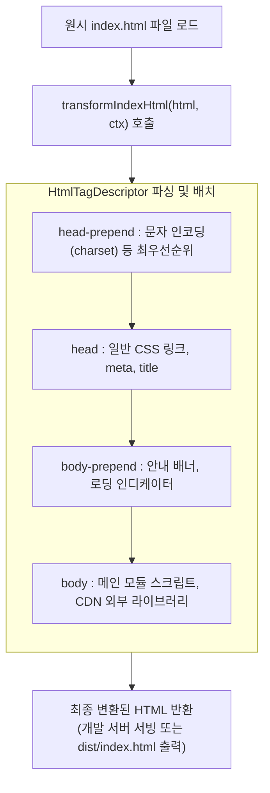

> Vite 애플리케이션에서 `index.html`은 단순한 번들 결과물 출력용 템플릿이 아니라 소스코드 의존성 그래프의 최상위 진입점(Entry Point)입니다. 본 글에서는 Vite의 `transformIndexHtml` 훅과 구조화된 태그 디스크립터(`HtmlTagDescriptor`)를 분석하고, 개발 환경과 프로덕션 환경에 따라 OpenGraph 메타 태그, Google Analytics, CDN 외부 스크립트를 안전하게 주입하는 커스텀 플러그인을 구현해 봅니다.

---

## 1. 배경: index.html 조작이 필요한 실무 시나리오

SPA(Single Page Application)를 운영하다 보면 배포 대상 환경(Local, Staging, Production)에 따라 `index.html` 마크업을 동적으로 제어해야 하는 상황이 빈번하게 발생합니다.

- **개발 환경 전용 시각 표시**: 개발자나 QA 담당자가 현재 접속한 환경이 실서버가 아님을 인지할 수 있도록 상단 경고 배너나 Git 브랜치 메타 태그를 주입.
- **검색엔진 크롤러 제어**: 개발 및 스테이징 환경에서는 `<meta name="robots" content="noindex, nofollow" />`를 삽입하여 검색엔진 색인 방지.
- **환경별 제3자 추적기(Tracker) 분리**: 프로덕션 배포 시에만 Google Tag Manager(GTM)나 GA4 추적 스크립트를 로드.
- **CDN 외부화(Externalization)**: 번들 크기를 줄이기 위해 대형 벤더 라이브러리(React, Vue, Lodash 등)를 번들에서 제외하고 CDN `<script>` 태그로 대체.

기존 번들러에서는 EJS나 Lodash 템플릿 엔진(`html-webpack-plugin`)을 사용해 조건부 문자열을 직접 작성해야 했지만, Vite는 **구조화된 객체 기반 태그 주입 훅**을 통해 훨씬 안전하고 선언적인 방식을 제공합니다.

---

## 2. transformIndexHtml 훅의 동작 원리와 규격

Vite 플러그인의 `transformIndexHtml` 훅은 개발 서버가 `index.html`을 서빙할 때와 프로덕션 `vite build` 시점에 모두 호출됩니다.



### 2.1 두 가지 반환 방식

1. **문자열 직접 변환 (String Replacement)**:
   ```typescript
   transformIndexHtml(html) {
     return html.replace(/<title>(.*?)<\/title>/, '<title>새로운 제목</title>');
   }
   ```
   정규식이나 문자열 치환을 사용하는 단순한 방식이지만, HTML 구조가 깨지거나 순서 제어가 어렵다는 한계가 있습니다.

2. **태그 디스크립터 반환 (Structured Tag Descriptors)**:
   ```typescript
   export interface HtmlTagDescriptor {
     tag: string;
     attrs?: Record<string, string | boolean | undefined>;
     children?: string | HtmlTagDescriptor[];
     injectTo?: 'head' | 'body' | 'head-prepend' | 'body-prepend';
   }
   ```
   Vite 내부 HTML 파서가 지정된 DOM 위치(`injectTo`)에 맞춰 태그를 올바른 위치에 자동으로 삽입합니다.

---

## 3. 실습: `vite-plugin-html-env` 플러그인 구현

배포 모드(`development` vs `production`)에 따라 메타 태그와 외부 CDN 스크립트를 다르게 주입하는 완성형 플러그인을 제작해 보겠습니다.

```typescript
// plugins/vite-plugin-html-env.ts
import type { Plugin, HtmlTagDescriptor, IndexHtmlTransformContext } from 'vite';

export interface HtmlEnvOptions {
  siteTitle: string;
  canonicalUrl?: string;
  gtmId?: string;
  enableCdn?: boolean;
}

export function htmlEnvPlugin(options: HtmlEnvOptions): Plugin {
  let isProduction = false;

  return {
    name: 'vite-plugin-html-env',

    configResolved(config) {
      isProduction = config.mode === 'production';
    },

    transformIndexHtml: {
      order: 'pre', // 다른 HTML 변환 플러그인보다 먼저 실행
      handler(html: string, ctx: IndexHtmlTransformContext): HtmlTagDescriptor[] {
        const tags: HtmlTagDescriptor[] = [];

        // 1. 공통 타이틀 태그 설정
        const titleText = isProduction ? options.siteTitle : `[DEV] ${options.siteTitle}`;
        tags.push({
          tag: 'title',
          children: titleText,
          injectTo: 'head',
        });

        if (!isProduction) {
          // 2. 개발 환경 전용: noindex 및 디버그 메타 태그, 경고 배너 주입
          tags.push(
            {
              tag: 'meta',
              attrs: { name: 'robots', content: 'noindex, nofollow' },
              injectTo: 'head',
            },
            {
              tag: 'meta',
              attrs: { name: 'app:env', content: 'development' },
              injectTo: 'head',
            },
            {
              tag: 'meta',
              attrs: { name: 'app:git-branch', content: 'feature/seo-transform' },
              injectTo: 'head',
            },
            {
              tag: 'div',
              attrs: {
                id: 'dev-banner',
                style: 'background:#f38ba8;color:#11111b;text-align:center;font-size:12px;padding:4px;font-weight:bold;',
              },
              children: '⚠️ LOCAL DEVELOPMENT ENVIRONMENT - DO NOT USE FOR PROD DATA',
              injectTo: 'body-prepend',
            }
          );
        } else {
          // 3. 프로덕션 환경 전용: OpenGraph 메타 태그 및 CDN, GTM 주입
          tags.push(
            {
              tag: 'meta',
              attrs: { property: 'og:title', content: options.siteTitle },
              injectTo: 'head',
            },
            {
              tag: 'meta',
              attrs: { property: 'og:type', content: 'website' },
              injectTo: 'head',
            },
            {
              tag: 'meta',
              attrs: { property: 'og:url', content: options.canonicalUrl || 'https://namju.kim' },
              injectTo: 'head',
            },
            {
              tag: 'meta',
              attrs: { property: 'og:image', content: `${options.canonicalUrl}/assets/images/og-main.png` },
              injectTo: 'head',
            }
          );

          if (options.gtmId) {
            tags.push({
              tag: 'script',
              attrs: {
                src: `https://www.googletagmanager.com/gtag/js?id=${options.gtmId}`,
                async: true,
              },
              injectTo: 'head',
            });
          }

          if (options.enableCdn) {
            tags.push({
              tag: 'script',
              attrs: {
                src: 'https://esm.sh/react@18.3.1',
                crossorigin: true,
              },
              injectTo: 'head',
            });
          }
        }

        return tags;
      },
    },
  };
}
```

이제 `vite.config.ts`에 플러그인을 등록합니다.

```typescript
// vite.config.ts
import { defineConfig } from 'vite';
import { htmlEnvPlugin } from './plugins/vite-plugin-html-env';

export default defineConfig({
  plugins: [
    htmlEnvPlugin({
      siteTitle: '커밋로그 대시보드',
      canonicalUrl: 'https://namju.kim',
      gtmId: 'G-TRACKER99',
      enableCdn: true,
    }),
  ],
});
```

---

## 4. 환경별 동작 검증

### 4.1 개발 서버(`npm run dev`)에서의 주입 결과

`npm run dev` 구동 후 로컬 HTTP 요청을 통해 반환되는 HTML 마크업을 확인합니다.


- `<head>` 영역에 `robots: noindex, nofollow` 및 `app:env: development` 메타 태그가 깔끔하게 주입되었습니다.
- `<body>`의 가장 첫머리(`body-prepend`)에 개발자 인지용 빨간색 경고 배너 `<div>`가 삽입되어 화면 최상단에 노출됩니다.

### 4.2 프로덕션 빌드(`npm run build --mode production`) 검증

이번에는 프로덕션 모드로 빌드를 수행한 뒤, 생성된 `dist/index.html`을 검사합니다.


- 개발 전용 배너와 `noindex` 태그는 완전히 제거되었습니다.
- OpenGraph 태그(`og:title`, `og:image`, `og:url`)와 Google Tag Manager 스크립트가 적절한 위치에 주입되어 완벽한 SEO 구성을 갖추었습니다.
- 빌드 최적화기에 의해 HTML 전체가 안전하게 단일 압축 라인으로 번들링되었습니다.

---

## 5. 실무 모범 사례

1. **`head-prepend`를 사용한 인코딩 및 CSP 태그 보장**:
   `<meta charset="UTF-8">`나 `<meta http-equiv="Content-Security-Policy">`는 브라우저 스펙상 문서의 가장 첫머리에 위치해야 합니다. 이 경우 `injectTo: 'head-prepend'`를 활용하여 순서를 엄격히 유지합니다.
2. **Rollup `external` 옵션과의 연계**:
   CDN 스크립트를 주입할 때는 `build.rollupOptions.external`에 해당 패키지(예: `['react', 'react-dom']`)를 등록하여 번들러가 번들 내부로 코드를 포함시키지 않도록 설정해야 이중 로딩을 방지할 수 있습니다.
3. **태그 객체 반환 방식 우선 사용**:
   정규식 문자열 치환은 HTML 주석 내부의 문자열이나 태그 속성값까지 오작동으로 치환할 위험이 크므로, 특별한 사유가 없는 한 `HtmlTagDescriptor` 배열 반환 방식을 사용하는 것이 안전합니다.

---

## 6. 마치며

`transformIndexHtml` 훅을 사용하면 번들링 파이프라인의 시작점인 HTML을 정교하게 제어할 수 있으며, 환경 분기 로직을 소스코드 외부에서 깔끔하게 관리할 수 있습니다.

다음 포스트에서는 파일 변환 훅(`transform`)을 활용하여 마크다운(`.md`) 문서를 파싱하고 런타임 컴포넌트로 자동 변환하는 **마크다운 컴파일러 플러그인**을 구현해 보겠습니다.
