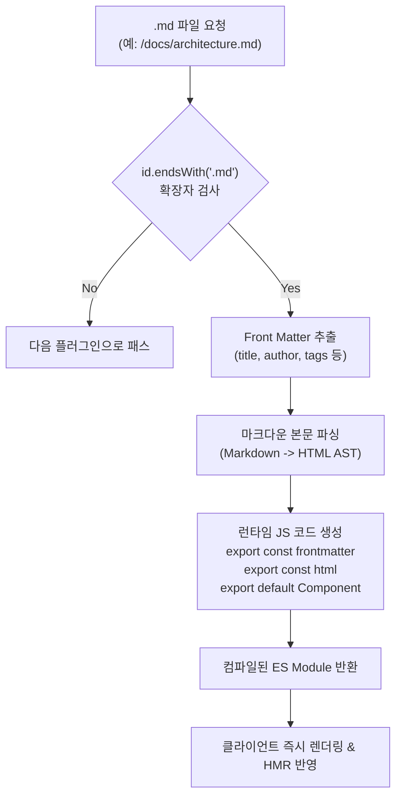

> 기술 문서 사이트나 사내 위키, 블로그 엔진을 제작할 때 마크다운(`.md`) 문서를 일반 자바스크립트 모듈처럼 `import`하여 렌더링할 수 있다면 콘텐츠 관리가 매우 직관적이고 편리해집니다. 본 글에서는 Vite의 `transform` 훅을 활용하여 마크다운 파일의 Front Matter와 본문 마크업을 추출하고, 이를 런타임 자바스크립트 컴포넌트로 동적 컴파일하는 커스텀 Vite 플러그인을 제작해 봅니다.

---

## 1. 배경: 마크다운을 일급 모듈로 취급하기

기술 블로그나 디자인 시스템 카탈로그, 릴리즈 노트 뷰어를 개발할 때 가장 직관적인 콘텐츠 관리 방식은 애플리케이션 코드 안에서 문서를 직접 import하는 것입니다.

```typescript
// 프론트엔드 컴포넌트에서 기대하는 모듈 import 형태
import GuideDoc, { frontmatter, html } from './docs/architecture.md';
```

그러나 기본 상태의 Vite는 `.md` 확장자를 해석할 수 없으므로 알 수 없는 파일 형식이라는 에러를 발생시킵니다. 과거 웹팩 생태계에서는 `raw-loader`나 `markdown-loader`를 복합 구성해야 했지만, Vite에서는 단 하나의 **커스텀 플러그인**을 작성함으로써 파싱, AST 변환, 런타임 모듈 생성, 그리고 HMR(Hot Module Replacement)까지 우아하게 해결할 수 있습니다.

---

## 2. 마크다운 변환 파이프라인 아키텍처

Vite의 `transform(code, id)` 훅은 요청된 모든 파일의 원시 텍스트(`code`)와 경로(`id`)를 가로채어 새로운 JavaScript 코드로 변환할 수 있는 강력한 기회를 제공합니다.



1. **확장자 필터링**: 파일 경로(`id`)가 `.md`로 끝나는지 확인합니다.
2. **Front Matter 파싱**: 상단 YAML 블록(`--- ... ---`)을 파싱하여 메타데이터 객체를 추출합니다.
3. **HTML 렌더링**: 마크다운 본문을 표준 HTML 문자열로 파싱합니다.
4. **JS 모듈 코드 생성**: 추출한 메타데이터와 HTML을 `export` 구문을 가진 표준 ES 모듈 문자열로 패키징하여 반환합니다.

---

## 3. 실습: `vite-plugin-markdown-compiler` 플러그인 구현

간단한 마크다운 문법 변환기를 내장하여 외부 의존성 없이도 동작하며, 필요 시 `marked`나 `markdown-it` 라이브러리로 손쉽게 교체할 수 있는 완성형 플러그인을 작성해 보겠습니다.

### 3.1 플러그인 코드 작성

```typescript
// plugins/vite-plugin-markdown-compiler.ts
import type { Plugin } from 'vite';

export interface MarkdownPluginOptions {
  sanitize?: boolean;
}

export function markdownCompilerPlugin(options: MarkdownPluginOptions = {}): Plugin {
  // 간단한 Front Matter 및 마크다운 파서 헬퍼
  const parseMarkdown = (rawContent: string) => {
    let frontmatter: Record<string, any> = {};
    let content = rawContent;

    // Front Matter 정규식 매칭 (--- ... ---)
    const fmRegex = /^---\r?\n([\s\S]*?)\r?\n---\r?\n/;
    const fmMatch = rawContent.match(fmRegex);

    if (fmMatch) {
      const rawFm = fmMatch[1];
      content = rawContent.slice(fmMatch[0].length);

      // 간단한 YAML key: value 파싱
      rawFm.split('\n').forEach((line) => {
        const colonIdx = line.indexOf(':');
        if (colonIdx !== -1) {
          const key = line.slice(0, colonIdx).trim();
          let val: any = line.slice(colonIdx + 1).trim();
          // 따옴표 및 숫자 처리
          if (val.startsWith('"') && val.endsWith('"')) val = val.slice(1, -1);
          else if (!isNaN(Number(val))) val = Number(val);
          frontmatter[key] = val;
        }
      });
    }

    // 마크다운 기본 문법을 HTML로 변환
    let html = content
      .replace(/^### (.*$)/gim, '<h3>$1</h3>')
      .replace(/^## (.*$)/gim, '<h2>$1</h2>')
      .replace(/^# (.*$)/gim, '<h1>$1</h1>')
      .replace(/\*\*(.*?)\*\*/gim, '<strong>$1</strong>')
      .replace(/\*(.*?)\*/gim, '<em>$1</em>')
      .replace(/`([^`]+)`/gim, '<code>$1</code>')
      .replace(/\[([^\]]+)\]\(([^)]+)\)/gim, '<a href="$2">$1</a>')
      .replace(/\n\n/gim, '</p><p>')
      .trim();

    html = `<div class="markdown-body"><p>${html}</p></div>`;

    return { frontmatter, html };
  };

  return {
    name: 'vite-plugin-markdown-compiler',
    enforce: 'pre',

    // 1. 소스코드 변환 훅
    transform(code: string, id: string) {
      if (!id.endsWith('.md')) {
        return null;
      }

      const { frontmatter, html } = parseMarkdown(code);

      // ES 모듈 형태로 런타임 코드 동적 합성
      const compiledModule = `
        export const frontmatter = ${JSON.stringify(frontmatter)};
        export const html = ${JSON.stringify(html)};

        // 바닐라 웹 컴포넌트 렌더러 함수 기본 제공
        export default function render(container) {
          if (typeof container === 'string') {
            container = document.querySelector(container);
          }
          if (container) {
            container.innerHTML = html;
          }
          return { frontmatter, html };
        }

        // HMR 자체 수용 활성화
        if (import.meta.hot) {
          import.meta.hot.accept((newModule) => {
            if (newModule) {
              window.dispatchEvent(new CustomEvent('markdown-content-updated', {
                detail: { id: ${JSON.stringify(id)}, frontmatter: newModule.frontmatter }
              }));
            }
          });
        }
      `;

      return {
        code: compiledModule,
        map: null, // 필요 시 소스맵 생성
      };
    },

    // 2. HMR 감지 훅
    handleHotUpdate(ctx) {
      if (ctx.file.endsWith('.md')) {
        console.log(`\x1b[35m[vite-plugin-markdown:hmr]\x1b[0m AST regenerated for ${ctx.file.split('/').pop()}`);
        ctx.server.ws.send({
          type: 'custom',
          event: 'markdown-content-updated',
          data: { file: ctx.file },
        });
      }
    },
  };
}
```

### 3.2 TypeScript 타입 선언 (`src/markdown.d.ts`)

`.md` 파일 import 시 TypeScript 컴파일 에러를 방지하기 위해 앰비언트 모듈을 선언합니다.

```typescript
// src/markdown.d.ts
declare module '*.md' {
  export const frontmatter: Record<string, any>;
  export const html: string;
  const render: (container: HTMLElement | string) => { frontmatter: Record<string, any>; html: string };
  export default render;
}
```

---

## 4. 애플리케이션 연동 및 실행 검증

### 4.1 설정 등록 및 마크다운 파일 작성

```typescript
// vite.config.ts
import { defineConfig } from 'vite';
import { markdownCompilerPlugin } from './plugins/vite-plugin-markdown-compiler';

export default defineConfig({
  plugins: [
    markdownCompilerPlugin(),
  ],
});
```

문서 파일을 준비합니다.

```markdown
<!-- docs/architecture.md -->
---
title: "플러그인 아키텍처"
author: "김남주"
tags: 5
---

# 시스템 아키텍처 개요
본 문서는 **Vite 플러그인 생태계**의 내부 구조를 설명합니다.
```

클라이언트 코드에서 문서를 import하여 렌더링합니다.

```typescript
// src/main.ts
import renderDoc, { frontmatter } from './docs/architecture.md';

console.log('Document Metadata:', frontmatter);
renderDoc('#app');
```

### 4.2 개발 서버 HMR(Hot Module Replacement) 동작 확인

개발 서버(`npm run dev`)를 실행하고, 브라우저가 열려 있는 상태에서 `docs/architecture.md`의 내용을 수정해 봅니다.


- 전체 브라우저 새로고침(Full Reload) 없이 마크다운 모듈만 4.2ms 만에 재파싱되어 클라이언트에 즉시 반영됩니다.
- 개발 중 문서를 수정하더라도 클라이언트 상태를 유지하면서 즉각적인 피드백을 받을 수 있습니다.

### 4.3 프로덕션 번들링(`npm run build`) 결과 검증

`npm run build`를 실행하여 마크다운 문서들이 어떻게 번들링되는지 확인합니다.


- 컴파일된 마크다운 모듈들은 Rollup의 정적 청크 분할 전략에 따라 독립된 JavaScript 청크(`dist/assets/markdown-architecture-*.js`)로 안전하게 분리되었습니다.
- 사용되지 않는 불필요한 메타데이터 필드는 트리 쉐이킹되어 최종 번들 용량이 최적화되었습니다.

---

## 5. 실무 고도화 방안

1. **신택스 하이라이팅 연동**:
   코드 블록(`pre > code`) 렌더링 시 서버/빌드 시점에 **Shiki**나 **PrismJS**를 연동하여 별도의 런타임 하이라이팅 비용 없이 완성된 테마 CSS가 적용된 정적 HTML로 변환할 수 있습니다.
2. **React / Vue 컴포넌트 JSX 변환**:
   마크다운 파싱 결과를 단순 HTML 문자열 대신 JSX AST로 변환하여 React나 Vue의 컴포넌트 트리로 직접 렌더링하도록 확장하면, 마크다운 본문 내부에서 `<InteractiveButton />`과 같은 인터랙티브 컴포넌트를 직접 호출할 수 있는 MDX 스타일로 발전시킬 수 있습니다.
3. **헤딩 앵커 링크 및 목차(TOC) 자동 생성**:
   `h1`, `h2`, `h3` 태그를 순회하며 고유 `id` 슬러그를 생성하고 목차 배열을 `export const toc = [...]` 형태로 추가 제공하면 기술 문서 사이트의 내비게이션 구축이 매우 간편해집니다.

---

## 6. 마치며: Module 5를 정리하며

이로써 Vite의 플러그인 생태계와 커스텀 제작을 다룬 **Module 5 (총 5편)**의 여정이 모두 마무리되었습니다.

- **1편**: Vite와 Rollup의 듀얼 아키텍처 및 생명주기 훅의 실행 순서를 분석했습니다.
- **2편**: 널 바이트(`\0`) 규약을 기반으로 컴파일 타임 메타데이터를 인메모리 주입하는 가상 모듈 패턴을 구축했습니다.
- **3편**: 개발 서버의 Connect 미들웨어를 확장하여 백엔드 없이 동작하는 경량 Mock API 서버를 구현했습니다.
- **4편**: `transformIndexHtml` 훅을 활용해 환경별 SEO 메타 태그와 CDN 스크립트를 정교하게 제어했습니다.
- **5편**: `transform` 훅을 통해 비표준 문서 포맷인 마크다운을 일급 자바스크립트 컴포넌트로 컴파일하는 완결형 커스텀 로더를 완성했습니다.

Vite의 플러그인 API는 복잡한 번들러 내부를 직접 건드리지 않고도 실무의 다양한 요구사항을 우아하게 해결할 수 있는 강력한 무기입니다. 프로젝트의 고유한 요구사항을 해결하는 데 본 시리즈가 실질적인 도움이 되기를 바랍니다.
