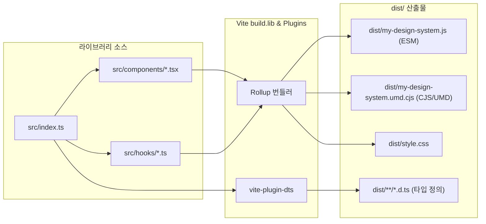

> Vite의 `build.lib` 설정과 Rollup 옵션을 활용하면 HTML 진입점 기반의 웹 앱 번들링을 넘어, 사내외에서 재사용 가능한 npm 라이브러리를 손쉽게 제작할 수 있습니다. 본 글에서는 React 및 TypeScript 공통 UI 패키지를 ESM과 CJS 멀티 포맷으로 컴파일하고, `vite-plugin-dts`를 통한 타입 정의 생성부터 모던 `package.json`의 `exports` 맵 구성 및 `npm pack` 무결성 검증까지의 전 과정을 실무 관점에서 정리합니다.

---

## 1. 애플리케이션 번들링과 라이브러리 번들링의 차이

일반적인 프론트엔드 웹 애플리케이션 빌드는 `index.html`을 최상위 루트로 삼아 자바스크립트, CSS, 정적 에셋을 단일 실행 환경에 맞춰 번들링하고 해시(`[name]-[hash].js`)가 붙은 청크로 분할합니다. 또한 `node_modules`에 위치한 모든 외부 의존성(React, Lodash 등)을 번들 내부에 직접 인라인 포함시킵니다.

반면 npm 저장소에 배포되는 공통 라이브러리는 전혀 다른 번들링 규칙을 요구합니다:

1. **HTML 파일 불필요**: 브라우저 진입점이 아닌 자바스크립트 모듈 엔트리(`src/index.ts`)를 직접 지정해야 합니다.
2. **소비자(Consumer) 환경 대응**: ESM(`import`)을 사용하는 최신 번들러 환경과 CJS(`require`)를 사용하는 기존 Node.js 환경 모두를 지원할 수 있는 듀얼 포맷 출력이 필요합니다.
3. **외부 의존성 분리(Externalization)**: React, React DOM 등의 런타임 라이브러리를 자체 번들에 포함하면 소비자의 프로젝트와 중복 번들링되어 런타임 싱글톤 깨짐(Invalid hook call 등)이 발생하므로 반드시 번들에서 제외해야 합니다.
4. **타입 정의 파일(`.d.ts`) 동봉**: TypeScript 환경에서 완벽한 자동완성과 정적 타입 추론을 제공하기 위한 선언 파일이 함께 생성되어야 합니다.



---

## 2. Vite 라이브러리 모드(`build.lib`) 설정

Vite에서 라이브러리 모드를 활성화하려면 `vite.config.ts`의 `build.lib` 객체에 엔트리 파일 경로와 출력 포맷을 지정합니다.

```typescript
// vite.config.ts
import { defineConfig } from 'vite';
import react from '@vitejs/plugin-react';
import dts from 'vite-plugin-dts';
import { resolve } from 'path';

export default defineConfig({
  plugins: [
    react(),
    // TypeScript 선언 파일(*.d.ts) 자동 생성 플러그인
    dts({
      tsconfigPath: './tsconfig.json',
      outDir: 'dist',
      insertTypesEntry: true,
      rollupTypes: false
    })
  ],
  build: {
    // 라이브러리 모드 설정
    lib: {
      entry: resolve(__dirname, 'src/index.ts'),
      name: 'NamjuDesignSystem', // UMD 글로벌 변수명
      formats: ['es', 'umd'],
      fileName: (format) => `my-design-system.${format === 'es' ? 'js' : 'umd.cjs'}`
    },
    rollupOptions: {
      // 라이브러리에 포함하지 않고 소비자 프로젝트에서 제공받을 외부 의존성
      external: ['react', 'react-dom', 'react/jsx-runtime'],
      output: {
        // UMD 빌드 시 외부 의존성을 전역 스코프에서 찾을 변수명 매핑
        globals: {
          react: 'React',
          'react-dom': 'ReactDOM',
          'react/jsx-runtime': 'jsxRuntime'
        },
        // CSS 클래스 및 에셋 이름 고정
        assetFileNames: (assetInfo) => {
          if (assetInfo.name === 'style.css') return 'style.css';
          return assetInfo.name || 'asset';
        }
      }
    },
    // 소스맵 생성 (디버깅 편의 제공)
    sourcemap: true,
    // 빈 디렉토리 초기화
    emptyOutDir: true
  }
});
```

> `external` 배열에 등록된 모듈은 번들 결과물에서 제외되고 `import { ... } from 'react'` 형태로 외부 참조만 남게 됩니다. 이를 통해 번들 크기를 비약적으로 줄이고 소비자 측 리액트 인스턴스와 충돌을 방지합니다.
{: .prompt-info }

---

## 3. 라이브러리 소스 코드 구조

예제로 사용할 컴포넌트 라이브러리는 버튼 컴포넌트와 모달 훅으로 구성됩니다.

```typescript
// src/components/Button.tsx
import React from 'react';
import './Button.css';

export interface ButtonProps extends React.ButtonHTMLAttributes<HTMLButtonElement> {
  variant?: 'primary' | 'secondary' | 'danger';
  size?: 'sm' | 'md' | 'lg';
}

export const Button: React.FC<ButtonProps> = ({
  variant = 'primary',
  size = 'md',
  children,
  className = '',
  ...props
}) => {
  return (
    <button
      className={`nds-button nds-button--${variant} nds-button--${size} ${className}`}
      {...props}
    >
      {children}
    </button>
  );
};
```

```typescript
// src/index.ts
// 공통 컴포넌트 엔트리 포인트
export { Button } from './components/Button';
export type { ButtonProps } from './components/Button';

export { Modal } from './components/Modal';
export type { ModalProps } from './components/Modal';

export { useModal } from './hooks/useModal';
```

---

## 4. 빌드 파이프라인 실행 및 결과 검증

설정을 마친 후 `pnpm build`를 실행하면 Vite가 Rollup과 `vite-plugin-dts`를 연계하여 ESM/CJS 번들과 타입 선언 파일들을 한 번에 출력합니다.

```bash
# 라이브러리 빌드 실행
pnpm build
```

빌드가 완료되면 터미널에 ESM 번들(`my-design-system.js`), UMD/CJS 번들(`my-design-system.umd.cjs`), 분리된 스타일시트(`style.css`), 그리고 컴포넌트별 `.d.ts` 타입 정의 파일들이 일목요연하게 출력됩니다.


_Vite build.lib와 vite-plugin-dts를 통한 ESM/CJS 멀티 포맷 및 타입 정의 빌드 산출물_

---

## 5. package.json 필드 구성과 Conditional Exports

빌드된 산출물을 소비자가 올바르게 불러올 수 있도록 `package.json`의 메타데이터를 정교하게 선언해야 합니다. 특히 최신 Node.js 환경의 `exports` 필드를 작성할 때는 `types`, `import`, `require`의 우선순위 순서를 지켜야 합니다.

```json
// package.json
{
  "name": "@namju/design-system",
  "version": "1.0.0",
  "description": "공통 React 디자인 시스템 컴포넌트 라이브러리",
  "type": "module",
  "main": "./dist/my-design-system.umd.cjs",
  "module": "./dist/my-design-system.js",
  "types": "./dist/index.d.ts",
  "exports": {
    ".": {
      "types": "./dist/index.d.ts",
      "import": "./dist/my-design-system.js",
      "require": "./dist/my-design-system.umd.cjs"
    },
    "./style.css": "./dist/style.css"
  },
  "files": [
    "dist",
    "README.md",
    "LICENSE"
  ],
  "sideEffects": [
    "**/*.css"
  ],
  "peerDependencies": {
    "react": "^18.0.0 || ^19.0.0",
    "react-dom": "^18.0.0 || ^19.0.0"
  },
  "devDependencies": {
    "@types/react": "^18.3.0",
    "@types/react-dom": "^18.3.0",
    "@vitejs/plugin-react": "^4.3.0",
    "typescript": "^5.6.0",
    "vite": "^5.4.8",
    "vite-plugin-dts": "^4.2.1"
  }
}
```

### 핵심 필드 설명

1. **`exports` 조건부 매핑**:
   - `types` 조건은 항상 `import` 및 `require`보다 **가장 상단에 먼저 위치**해야 TypeScript 컴파일러가 해당 포맷의 타입 정의를 올바르게 인식합니다.
   - 별도로 CSS를 임포트해야 하는 경우 `"./style.css"` 서브패스 매핑을 명시합니다.
2. **`files` 화이트리스트**:
   - `npm publish` 시 배포에 포함할 경로를 선언합니다. `dist` 폴더와 문서 파일만 포함하여 불필요한 소스나 설정 파일이 패키지에 섞여 들어가지 않도록 보호합니다.
3. **`sideEffects`**:
   - 소비자 번들러의 트리 쉐이킹(Tree-shaking)을 위해 대부분의 JS 코드가 순수함을 선언하되, CSS 스타일 파일(`**/*.css`)은 빌드 시 누락되지 않도록 사이드 이펙트로 지정합니다.
4. **`peerDependencies`**:
   - 소비자 프로젝트가 보유한 React 버전을 공유하겠다는 선언입니다. `dependencies`에 React를 선언하면 안 됩니다.

---

## 6. npm pack을 활용한 배포 타르볼 무결성 검증

패키지를 실제 npm 레지스트리에 배포하기 전에 불필요한 파일이 포함되었거나 필수적인 `.d.ts` 및 번들이 누락되지 않았는지 로컬에서 반드시 시뮬레이션해야 합니다.

`npm pack --dry-run` 명령어를 실행하면 실제 `.tgz` 아카이브를 디스크에 생성하지 않고 압축 대상 파일 목록, 용량, 무결성 해시를 미리 검증할 수 있습니다.

```bash
# 배포 타르볼 사전 무결성 점검
npm pack --dry-run
```


_npm pack --dry-run 명령어를 통한 배포 파일 및 패키지 무결성 사전 검증 화면_

터미널 출력 결과를 확인하여:
- `dist/index.d.ts`를 포함한 모든 타입 파일이 누락 없이 담겼는지
- 번들 결과물 크기(`package size`)가 적절한지
- `.git`, `src/`, `tsconfig.json` 등의 개발 전용 파일이 완전히 배제되었는지 점검합니다.

---

## 7. 실무 배포 시 추가 고려사항

### 7.1 CSS 인라인 주입 vs 별도 CSS 파일 분리
기본적으로 Vite는 컴포넌트에서 임포트한 CSS를 `dist/style.css`로 자동 추출합니다. 소비자는 다음과 같이 최상단에서 스타일시트를 1회 임포트해야 합니다:

```typescript
// 소비자 프로젝트 진입점 (main.tsx)
import '@namju/design-system/style.css';
import { Button } from '@namju/design-system';
```

만약 소비자가 CSS 파일을 별도로 임포트하지 않고 자바스크립트 모듈 실행 시 동적으로 `<style>` 태그를 주입받게 만들고 싶다면 `vite-plugin-css-injected-by-js` 플러그인을 채택할 수 있습니다. 다만 이 경우 SSR 환경에서 깜빡임(FOUC)이 발생할 수 있으므로, 공통 UI 라이브러리는 별도 `style.css` 추출 방식을 유지하는 편이 더 권장됩니다.

### 7.2 로컬 심볼릭 링크를 통한 소비자 테스트
배포 전 소비자 앱에서 라이브러리를 직접 테스트하려면 `npm link` 또는 `pnpm link`를 활용합니다:

```bash
# 1. 라이브러리 디렉토리에서 글로벌 링크 등록
cd packages/design-system
pnpm link --global

# 2. 테스트용 웹 앱 디렉토리에서 패키지 연결
cd apps/demo-app
pnpm link --global @namju/design-system
```

---

## 8. 마치며

과거에는 Webpack과 Rollup 설정을 복잡하게 구성하거나 별도의 번들 도구(`tsup`, `microbundle` 등)를 추가로 도입해야만 공통 라이브러리를 만들 수 있었습니다. 하지만 Vite의 `build.lib` 모드를 활용하면 웹 애플리케이션에서 사용하던 동일한 개발 경험과 Rollup 플러그인 생태계를 그대로 누리면서 완성도 높은 npm 패키지를 제작할 수 있습니다.

공통 컴포넌트나 비즈니스 로직을 사내 패키지로 모듈화할 계획이 있다면, Vite 라이브러리 모드와 `vite-plugin-dts`를 기반으로 표준 패키지 번들링 환경을 구축해 보시기를 추천합니다.


