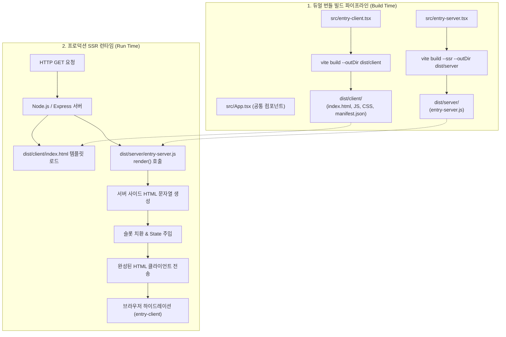

> Vite는 상위 메타 프레임워크(Next.js, Remix, Nuxt 등)에 종속되지 않고 개발자가 직접 커스텀 SSR(서버 사이드 렌더링) 아키텍처를 설계할 수 있는 강력한 저수준(low-level) SSR API를 기본 제공합니다. 본 글에서는 브라우저 DOM 하이드레이션을 담당하는 클라이언트 엔트리와 Node.js 런타임에서 HTML을 생성하는 서버 엔트리의 분리 설계, `vite build --ssr`을 활용한 듀얼 번들 파이프라인 구축, 그리고 Express 기반 프로덕션 SSR 서버 서빙과 HTML 무결성 검증 과정을 상세히 정리합니다.

---

## 1. 배경: 메타 프레임워크 이전의 Vite 저수준 SSR 이해

현대 웹 개발에서 SSR을 구현할 때 대다수는 Next.js나 Nuxt 같은 완성형 프레임워크를 선택합니다. 하지만 다음과 같은 실무 요구사항이 발생할 때 상위 프레임워크는 종종 지나치게 무겁거나 기존 인프라와의 통합에 제약을 주기도 합니다:

- 기존 Node.js/Express 마이크로서비스 백엔드 프로세스 내에 프론트엔드 SSR 렌더러를 직접 내장해야 하는 경우
- 특수한 세션/보안 쿠키 핸들링 및 커스텀 로드밸런서 라우팅 규칙을 서버 레벨에서 정교하게 제어해야 하는 경우
- 특정 메타 프레임워크의 독자적인 디렉토리 라우팅 규칙에 종속되지 않고 순수한 React/Vue 아키텍처를 유지하고 싶은 경우

Vite는 이러한 시나리오를 위해 프레임워크에 독립적인(Framework-agnostic) SSR 빌드 엔진을 제공합니다. 개발 서버에서는 Vite 미들웨어를 통해 실시간 온디맨드 서버 트랜스파일을 지원하고, 프로덕션 빌드에서는 클라이언트 에셋과 서버 실행 코드를 별개의 번들로 컴파일할 수 있습니다.



---

## 2. 클라이언트와 서버 엔트리의 역할 분리

Vite SSR 아키텍처의 핵심은 단일 공통 애플리케이션 컴포넌트를 기반으로 브라우저용 엔트리와 서버용 엔트리를 물리적으로 분리하는 것입니다.

### 2.1 공통 앱 컴포넌트 (`src/App.tsx`)

클라이언트와 서버 양쪽에서 공통으로 마운트될 UI 컴포넌트입니다.

```typescript
// src/App.tsx
import React, { useState } from 'react';
import './App.css';

export interface UserState {
  id: number;
  role: string;
}

interface AppProps {
  initialUser?: UserState;
}

export const App: React.FC<AppProps> = ({ initialUser }) => {
  const [user] = useState<UserState>(initialUser || { id: 0, role: 'guest' });
  const [count, setCount] = useState(0);

  return (
    <div className="ssr-container">
      <header className="gnb">
        <h1>남주의 개발로그</h1>
      </header>
      <main className="container">
        <h2>서버 사이드 렌더링 초기 HTML</h2>
        <p>User ID: {user.id} ({user.role})</p>
        <button
          className="interactive-btn"
          onClick={() => setCount((prev) => prev + 1)}
        >
          Hydration 카운터: {count}
        </button>
      </main>
    </div>
  );
};
```

---

### 2.2 클라이언트 엔트리 (`src/entry-client.tsx`)

브라우저 환경에서 실행되며, 서버에서 이미 렌더링되어 내려온 DOM 트리에 이벤트 리스너를 결합하는 **하이드레이션(Hydration)** 작업을 수행합니다.

```typescript
// src/entry-client.tsx
import React from 'react';
import ReactDOM from 'react-dom/client';
import { App, UserState } from './App';

// 브라우저 윈도우 객체에서 서버가 주입한 초기 상태 수신
declare global {
  interface Window {
    __INITIAL_STATE__?: {
      user: UserState;
    };
  }
}

const initialState = window.__INITIAL_STATE__;
const container = document.getElementById('app');

if (container) {
  // SSR 환경에서는 createRoot 대신 hydrateRoot를 사용
  ReactDOM.hydrateRoot(
    container,
    <React.StrictMode>
      <App initialUser={initialState?.user} />
    </React.StrictMode>
  );
}
```

> SSR 결과물이 브라우저에 도달했을 때 `hydrateRoot`를 사용해야 서버가 만든 HTML 노드를 파괴하고 새로 그리는 깜빡임 없이 즉각적인 이벤트 바인딩이 이루어집니다.
{: .prompt-info }

---

### 2.3 서버 엔트리 (`src/entry-server.tsx`)

Node.js 환경에서 호출되며, 요청 URL과 서버 상태를 인자로 받아 문자열 형태의 HTML(`renderToString`)을 반환합니다.

```typescript
// src/entry-server.tsx
import React from 'react';
import ReactDOMServer from 'react-dom/server';
import { App, UserState } from './App';

export interface RenderContext {
  url: string;
  user: UserState;
}

export interface RenderResult {
  html: string;
  initialState: {
    user: UserState;
  };
}

export function render(context: RenderContext): RenderResult {
  const initialState = {
    user: context.user
  };

  const html = ReactDOMServer.renderToString(
    <React.StrictMode>
      <App initialUser={context.user} />
    </React.StrictMode>
  );

  return { html, initialState };
}
```

---

## 3. HTML 템플릿 슬롯 구성

`index.html` 파일에는 서버가 생성한 HTML 문자열과 초기 상태를 주입할 플레이스홀더를 배치합니다.

```html
<!-- index.html -->
<!DOCTYPE html>
<html lang="ko">
  <head>
    <meta charset="UTF-8" />
    <meta name="viewport" content="width=device-width, initial-scale=1.0" />
    <title>Vite SSR Production</title>
    <!--app-head-->
  </head>
  <body>
    <div id="app"><!--app-html--></div>
    <!--app-state-->
    <script type="module" src="/src/entry-client.tsx"></script>
  </body>
</html>
```

---

## 4. 듀얼 번들 빌드 스크립트 설정

프로덕션 배포를 위해서는 클라이언트용 정적 에셋(브라우저 번들, CSS, 이미지)과 Node.js용 서버 모듈(`entry-server.js`)을 각각 빌드해야 합니다.

`package.json`의 스크립트를 다음과 같이 정의합니다:

```json
// package.json
{
  "name": "vite-ssr-app",
  "version": "1.0.0",
  "type": "module",
  "scripts": {
    "dev": "node server.js",
    "build:client": "vite build --outDir dist/client",
    "build:server": "vite build --ssr src/entry-server.tsx --outDir dist/server",
    "build:ssr": "pnpm build:client && pnpm build:server",
    "serve": "cross-env NODE_ENV=production node server.js"
  },
  "dependencies": {
    "compression": "^1.7.4",
    "express": "^4.21.0",
    "react": "^18.3.1",
    "react-dom": "^18.3.1",
    "sirv": "^2.0.4"
  },
  "devDependencies": {
    "@types/compression": "^1.7.5",
    "@types/express": "^4.17.21",
    "@types/react": "^18.3.11",
    "@types/react-dom": "^18.3.0",
    "@vitejs/plugin-react": "^4.3.2",
    "cross-env": "^7.0.3",
    "typescript": "^5.6.3",
    "vite": "^5.4.8"
  }
}
```

### 듀얼 빌드 파이프라인 검증

`pnpm run build:ssr`을 실행하여 클라이언트 번들과 SSR 전용 번들이 정상적으로 분리 생성되는지 확인합니다.

```bash
# 클라이언트 및 서버 듀얼 번들 빌드 실행
pnpm run build:ssr
```


_Vite SSR 듀얼 번들 파이프라인 빌드 결과 (dist/client 정적 파일 및 dist/server/entry-server.js 생성)_

터미널 출력을 살펴보면:
1. `dist/client/`: 프로덕션 클라이언트 번들 JS, 해시된 CSS 에셋, 빌드 매니페스트(`manifest.json`)가 생성됩니다.
2. `dist/server/`: Node.js 런타임에서 호출할 수 있는 단일 `entry-server.js` 파일이 가볍게 번들링됩니다.

---

## 5. 프로덕션 Node.js SSR 서버 구현

빌드된 산출물을 조합하여 클라이언트의 요청마다 완성된 HTML을 반환하는 Express 서버 코드입니다.

```typescript
// server.js
import fs from 'node:fs';
import path from 'node:path';
import { fileURLToPath } from 'node:url';
import express from 'express';
import compression from 'compression';
import sirv from 'sirv';

const __dirname = path.dirname(fileURLToPath(import.meta.url));
const isProduction = process.env.NODE_ENV === 'production';

async function createServer() {
  const app = express();
  app.use(compression());

  if (isProduction) {
    // 1. 프로덕션 환경: dist/client 정적 파일 서빙 (캐싱 적용)
    app.use(
      sirv(path.resolve(__dirname, 'dist/client'), {
        extensions: []
      })
    );
  }

  // 2. SSR 렌더링 핸들러
  app.use('*', async (req, res, next) => {
    const url = req.originalUrl;

    try {
      let template;
      let render;

      if (isProduction) {
        // 프로덕션: 미리 빌드된 index.html과 entry-server.js 로드
        template = fs.readFileSync(
          path.resolve(__dirname, 'dist/client/index.html'),
          'utf-8'
        );
        const serverEntry = await import('./dist/server/entry-server.js');
        render = serverEntry.render;
      } else {
        // 개발 모드: Vite 개발 서버 미들웨어 연동 (생략)
        return next();
      }

      // 서버 비즈니스 로직 / 인증 정보 조회 시뮬레이션
      const mockUser = { id: 1, role: 'admin' };

      // 서버 사이드 렌더링 수행
      const { html: appHtml, initialState } = render({
        url,
        user: mockUser
      });

      // 템플릿 치환: HTML 마크업 및 하이드레이션 직렬화 상태 주입
      const stateScript = `<script>window.__INITIAL_STATE__=${JSON.stringify(initialState)}</script>`;
      const finalHtml = template
        .replace('<!--app-html-->', appHtml)
        .replace('<!--app-state-->', stateScript);

      res.status(200).set({ 'Content-Type': 'text/html' }).end(finalHtml);
    } catch (e) {
      console.error('SSR Render Error:', e);
      res.status(500).end(e.stack);
    }
  });

  const port = process.env.PORT || 5173;
  app.listen(port, () => {
    console.log(`Server listening on http://localhost:${port}`);
  });
}

createServer();
```

---

## 6. 프로덕션 서버 실행 및 HTML 응답 검증

빌드된 프로덕션 서버를 기동하고 `curl` 요청을 통해 서버 사이드 렌더링이 의도대로 완료되었는지 검증합니다.

```bash
# 프로덕션 서버 실행
pnpm serve

# 다른 터미널에서 HTTP 응답 점검
curl -i http://localhost:5173/
```


_Node SSR 서버에 curl 요청을 전송하여 서버 렌더링된 DOM 요소와 __INITIAL_STATE__ 상태 주입 검증_

검증 결과:
- `<div id="app">` 내부에 빈 껍데기가 아닌 `<header>`, `<h1>남주의 개발로그</h1>`, `<main>` 태그 등 완전한 렌더링 마크업이 서버에서 이미 완성되어 전달됩니다.
- 하단에 `<script>window.__INITIAL_STATE__={"user":{"id":1,"role":"admin"}}</script>`가 정상 주입되어 클라이언트 하이드레이션 시 데이터 불일치가 발생하지 않습니다.

---

## 7. 실무 SSR 설계 시 핵심 주의사항

### 7.1 하이드레이션 불일치(Hydration Mismatch) 방지
서버 렌더링 결과물과 브라우저 최초 마운트 시점의 렌더링 결과물이 다르면 React는 하이드레이션 경고를 출력하고 전체 DOM을 다시 렌더링합니다.
- `window`, `document`, `localStorage` 등 브라우저 전역 객체는 컴포넌트 렌더 바디에서 직접 접근하지 말고 반드시 `useEffect` 내부에서만 다뤄야 합니다.
- 서버와 클라이언트의 시간대(Timezone) 차이로 인해 날짜 포맷팅 문자열이 달라지지 않도록 주의해야 합니다.

### 7.2 메모리 누수와 요청 격리
Node.js 프로세스는 여러 사용자의 요청을 단일 인스턴스에서 동시 처리합니다. 따라서 모듈 최상단 스코프에 전역 상태 객체나 싱글톤 캐시를 선언하면 사용자 A의 데이터가 사용자 B에게 유출되는 심각한 보안 사고가 발생할 수 있습니다. 상태 컨테이너(Pinia, Redux, Zustand 등)는 반드시 요청 핸들러마다 새로 인스턴스화해야 합니다.

---

## 8. 마치며

Vite의 저수준 SSR 아키텍처는 현대 메타 프레임워크가 내부적으로 번들링을 어떻게 분리하고 서버와 클라이언트를 연결하는지 이해하는 가장 확실한 통로입니다. 또한 가벼운 맞춤형 SSR 서버가 필요할 때 복잡한 외부 프레임워크 도입 없이도 원하는 수준의 성능과 제어권을 완전히 확보할 수 있습니다.

프론트엔드 빌드 도구로서의 Vite를 넘어 서버 사이드 렌더링 파이프라인의 핵심 엔진으로서 Vite의 유연성을 적극 활용해 보시기를 권장합니다.


