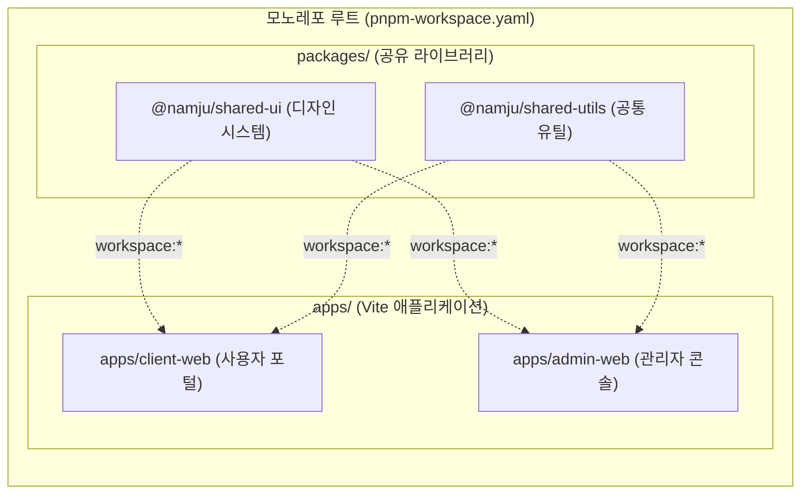

> 다수의 프론트엔드 프로젝트(예: 사용자 웹, 어드민 콘솔)를 운영할 때 공통 UI 컴포넌트와 비즈니스 유틸리티를 모노레포(Monorepo)로 통합하면 코드 재사용성과 유지보수성이 극대화됩니다. 본 글에서는 pnpm Workspaces의 고유한 심볼릭 링크 격리 아키텍처를 기반으로 Vite 서브 프로젝트를 구성하고, React 인스턴스 중복 방지(`resolve.dedupe`), 내부 패키지 실시간 HMR 설정, 그리고 의존성 위상 정렬(Topological) 재귀 빌드 검증까지 실무 모노레포 운영 노하우를 다룹니다.

---

## 1. 배경: 왜 pnpm Workspaces + Vite 조합인가?

프론트엔드 모노레포 도구로 Yarn Classic/Berry, npm, Lerna, Turborepo 등 다양한 선택지가 존재하지만, **pnpm Workspaces**와 **Vite**의 조합은 특히 개발 속도와 디스크 효율성 면에서 탁월한 시너지를 발휘합니다:

1. **디스크 절약 및 엄격한 격리**: pnpm은 글로벌 콘텐츠 주소 지정 저장소(Content-addressable store)와 하드 링크를 사용하여 중복 패키지 설치로 인한 디스크 낭비를 막고, 선언되지 않은 유령 의존성(Phantom dependency)을 엄격히 차단합니다.
2. **`workspace:*` 프로토콜**: 로컬 패키지 간 버전을 신경 쓸 필요 없이 항상 로컬 소스를 심볼릭 링크로 연결하여 즉각적인 동기화를 제공합니다.
3. **Vite의 빠른 개발 서버 연동**: 공통 라이브러리를 npm에 매번 발행하지 않고도 로컬 소스 코드 변경 시 Vite 개발 서버의 모듈 그래프가 이를 즉각 감지하여 초고속 HMR(Hot Module Replacement)을 수행할 수 있습니다.



---

## 2. pnpm Workspaces 디렉토리 구조 및 루트 설정

모노레포 프로젝트의 표준 디렉토리 구조는 다음과 같습니다:

```text
my-monorepo/
├── pnpm-workspace.yaml
├── package.json
├── tsconfig.base.json
├── packages/
│   └── shared-ui/
│       ├── package.json
│       ├── tsconfig.json
│       ├── vite.config.ts
│       └── src/
│           ├── index.ts
│           └── components/
└── apps/
    ├── client-web/
    │   ├── package.json
    │   ├── tsconfig.json
    │   ├── vite.config.ts
    │   └── src/
    └── admin-web/
        ├── package.json
        ├── tsconfig.json
        ├── vite.config.ts
        └── src/
```

### 2.1 루트 워크스페이스 선언 (`pnpm-workspace.yaml`)

루트 디렉토리에 `pnpm-workspace.yaml`을 생성하여 관리 대상 패키지 경로를 선언합니다.

```yaml
# pnpm-workspace.yaml
packages:
  - 'packages/*'
  - 'apps/*'
```

### 2.2 루트 `package.json`

루트에서는 워크스페이스 전체에 공통으로 필요한 린터, 포매터, 전역 빌드 스크립트를 정의합니다.

```json
// package.json (root)
{
  "name": "my-vite-monorepo",
  "version": "1.0.0",
  "private": true,
  "scripts": {
    "build": "pnpm -r run build",
    "dev:client": "pnpm --filter client-web dev",
    "dev:admin": "pnpm --filter admin-web dev",
    "lint": "pnpm -r run lint"
  },
  "devDependencies": {
    "prettier": "^3.3.3",
    "typescript": "^5.6.3"
  }
}
```

---

## 3. 공통 패키지(`packages/shared-ui`) 구성

공유 컴포넌트 패키지는 다른 Vite 앱에서 직접 소비되거나 독립 라이브러리로 빌드될 수 있도록 설정합니다.

```json
// packages/shared-ui/package.json
{
  "name": "@namju/shared-ui",
  "version": "1.0.0",
  "private": true,
  "type": "module",
  "main": "./src/index.ts",
  "types": "./src/index.ts",
  "exports": {
    ".": {
      "types": "./src/index.ts",
      "import": "./src/index.ts"
    }
  },
  "scripts": {
    "build": "vite build",
    "lint": "eslint src"
  },
  "peerDependencies": {
    "react": "^18.3.1",
    "react-dom": "^18.3.1"
  },
  "devDependencies": {
    "@types/react": "^18.3.11",
    "@types/react-dom": "^18.3.0",
    "@vitejs/plugin-react": "^4.3.2",
    "typescript": "^5.6.3",
    "vite": "^5.4.8"
  }
}
```

> 모노레포 내부 소비만을 목적으로 할 경우, `main`과 `exports`에 빌드된 `dist` 파일 대신 직접 `src/index.ts`를 가리키게 설정하면 별도의 빌드 과정 없이 소스 코드 레벨에서 실시간 HMR을 즉각 누릴 수 있습니다.
{: .prompt-tip }

---

## 4. Vite 서브 프로젝트(`apps/client-web`) 설정

서브 프로젝트에서 내부 워크스페이스 패키지를 사용할 때는 `package.json`에 `workspace:*` 의존성을 선언하고, `vite.config.ts`에서 심볼릭 링크 및 싱글톤 모듈 관련 옵션을 보정해야 합니다.

### 4.1 의존성 등록

```json
// apps/client-web/package.json
{
  "name": "client-web",
  "version": "1.0.0",
  "private": true,
  "type": "module",
  "scripts": {
    "dev": "vite",
    "build": "vite build",
    "preview": "vite preview"
  },
  "dependencies": {
    "@namju/shared-ui": "workspace:*",
    "react": "^18.3.1",
    "react-dom": "^18.3.1"
  },
  "devDependencies": {
    "@types/react": "^18.3.11",
    "@types/react-dom": "^18.3.0",
    "@vitejs/plugin-react": "^4.3.2",
    "typescript": "^5.6.3",
    "vite": "^5.4.8"
  }
}
```

---

### 4.2 `vite.config.ts` 핵심 튜닝 (중복 모듈 및 HMR 최적화)

모노레포 환경에서 자주 발생하는 가장 치명적인 문제는 심볼릭 링크로 연결된 패키지가 자체 `node_modules`의 React를 참조하면서 발생하는 **'Invalid hook call (React 중복 인스턴스)'** 오류입니다. 이를 해결하기 위해 `resolve.dedupe`를 명시합니다.

```typescript
// apps/client-web/vite.config.ts
import { defineConfig } from 'vite';
import react from '@vitejs/plugin-react';
import path from 'path';

export default defineConfig({
  plugins: [react()],
  resolve: {
    // 1. React 싱글톤 보장: 워크스페이스 심볼릭 링크 내부에서도 루트/앱의 단일 React 인스턴스를 강제 참조
    dedupe: ['react', 'react-dom'],
    alias: {
      // 필요 시 직접 경로 별칭 매핑
      '@': path.resolve(__dirname, './src')
    }
  },
  server: {
    port: 5173,
    watch: {
      // 2. 심볼릭 링크된 packages/ 디렉토리의 파일 변경 이벤트를 개발 서버가 감시할 수 있도록 허용
      ignored: ['!**/node_modules/@namju/shared-ui/**']
    }
  },
  optimizeDeps: {
    // 3. 로컬 워크스페이스 패키지는 esbuild 사전 번들링에서 제외하여 소스 코드 실시간 HMR 유지
    exclude: ['@namju/shared-ui']
  }
});
```

---

## 5. 의존성 위상 정렬 재귀 빌드 검증

pnpm은 패키지 간의 의존 관계 그래프(DAG)를 분석하여 선행 패키지를 먼저 빌드하는 **위상 정렬(Topological Sorting)**을 기본 지원합니다.

루트에서 `pnpm -r run build` 명령을 실행하여 의존성 순서에 따른 빌드를 검증합니다:

```bash
# 워크스페이스 전체 재귀 빌드 실행
pnpm -r run build
```


_pnpm -r run build 실행 시 @namju/shared-ui 라이브러리가 선행 빌드된 후 의존하는 앱들이 순차 빌드되는 모습_

출력 결과에서 확인할 수 있듯:
1. 최하단 의존성인 `packages/shared-ui`가 가장 먼저 빌드되고 타입 정의가 생성됩니다.
2. 이후 이를 참조하는 `apps/admin-web`과 `apps/client-web`이 순서대로 빌드되어 의존성 불일치 오류 없이 930ms 만에 전체 빌드가 완료됩니다.

---

## 6. 심볼릭 링크 실시간 HMR 감지 검증

모노레포 환경의 핵심 가치는 공통 라이브러리 코드를 수정했을 때, 이를 참조하는 웹 앱을 재빌드하거나 재부팅할 필요 없이 브라우저에 즉시 반영되는 개발 경험(DX)입니다.

개발 서버를 구동한 상태에서 공통 컴포넌트 소스를 수정해 봅니다:

```bash
# 클라이언트 웹 개발 서버 기동
pnpm --filter client-web dev
```

`packages/shared-ui/src/components/Button.tsx`와 `theme/tokens.ts`를 저장하는 순간, 터미널에 심볼릭 링크 파일 변경이 감지되며 즉각적인 HMR 업데이트가 발생합니다:


_packages/shared-ui 수정 시 apps/client-web Vite 개발 서버에서 20ms 내외로 즉각 HMR이 트리거되는 화면_

---

## 7. 실무 모노레포 운영 시 팁

### 7.1 TypeScript 프로젝트 레퍼런스(Project References)
모노레포 규모가 커지면 TypeScript 컴파일 속도가 저하될 수 있습니다. 이때 `tsconfig.json`에 `composite: true`와 `references`를 지정하면 변경된 패키지만 증분 컴파일(Incremental Compilation)할 수 있습니다.

```json
// apps/client-web/tsconfig.json
{
  "extends": "../../tsconfig.base.json",
  "compilerOptions": {
    "composite": true
  },
  "references": [
    { "path": "../../packages/shared-ui" }
  ]
}
```

### 7.2 배포 격리 (pnpm deploy)
Docker 컨테이너 이미지로 특정 앱(`client-web`)만 배포해야 할 때, 모노레포 전체를 복사하면 이미지 용량이 커집니다. `pnpm --filter client-web deploy /out/app` 명령을 사용하면 해당 앱과 의존하는 로컬 패키지만 추출된 깨끗한 프로덕션 배포 디렉토리를 생성할 수 있습니다.

---

## 8. 마치며

pnpm Workspaces의 고유한 디스크 절약 및 격리 메커니즘과 Vite의 초고속 모듈 서버가 결합하면, 복잡한 추가 오케스트레이션 도구 없이도 매우 민첩하고 견고한 프론트엔드 모노레포를 구축할 수 있습니다.

`resolve.dedupe`를 통한 모듈 싱글톤 보장과 `optimizeDeps.exclude`를 통한 소스 레벨 HMR 전략을 기억한다면, 다중 프로젝트 간 코드 공유의 효율성을 극대화할 수 있을 것입니다.


