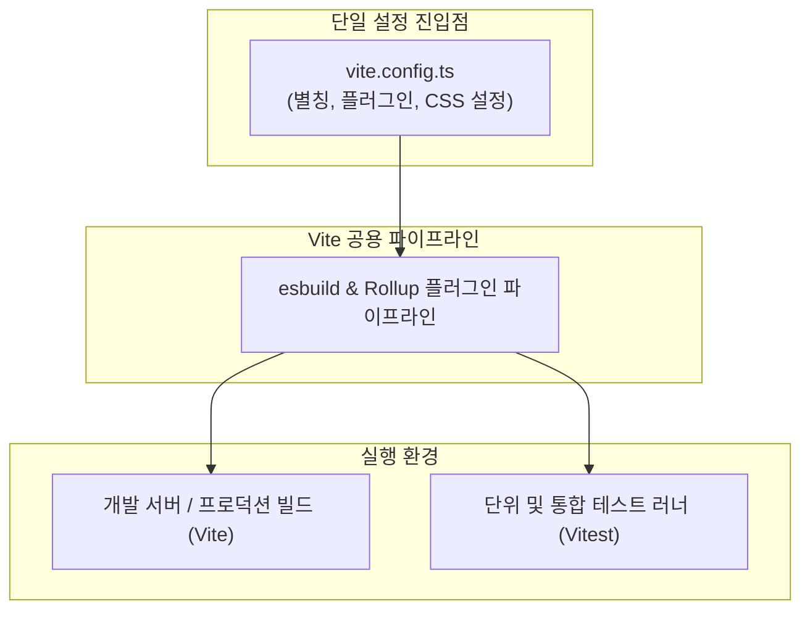

> Vite 기반 프로젝트에서 기존 Jest를 사용하면 빌드 설정(Vite)과 테스트 변환기(Babel/ts-jest)의 이원화로 인해 별칭(Alias)이나 플러그인 설정이 불일치하는 문제가 자주 발생합니다. Vitest는 Vite의 플러그인 파이프라인과 esbuild 변환기를 그대로 공유하는 네이티브 단위 테스트 러너입니다. 본 글에서는 Vitest의 도입 배경, `vitest/config` 환경 구성, `vi` 객체를 활용한 API 모킹 패턴, 그리고 `@vitest/coverage-v8`을 통한 커버리지 임계치 검증까지 실무 테스트 파이프라인 구축 과정을 정리합니다.

---

## 1. 배경: Jest의 한계와 Vitest의 등장

오랫동안 프론트엔드 표준 테스트 도구로 군림해 온 Jest는 매우 성숙한 프레임워크이지만, 현대적인 Vite 빌드 파이프라인과 결합할 때 다음과 같은 구조적 마찰을 겪게 됩니다:

1. **설정의 중복과 불일치**: Vite에서 정의한 경로 별칭(`@/`), CSS 전처리기 설정, SVG 변환 플러그인 등을 Jest에서 재현하려면 `jest.config.js`에 `moduleNameMapper`와 `transform` 설정을 일일이 복제해야 합니다.
2. **트랜스파일 파이프라인 이원화**: 개발 및 빌드는 초고속 `esbuild`와 `Rollup`으로 동작하지만, Jest는 내부적으로 무거운 `Babel`이나 `ts-jest`를 거쳐 테스트 구동 시 극심한 지연이 발생합니다.
3. **ESM(ECMAScript Modules) 지원 마찰**: Node.js 환경에서 Jest의 순수 ESM 패키지 처리는 여전히 까다로운 플래그(`--experimental-vm-modules`)를 요구합니다.

Vitest는 바로 이 문제를 근본적으로 해결하기 위해 만들어졌습니다. Vite 인스턴스 위에서 직접 실행되므로 **동일한 `vite.config.ts` 설정 파일을 단 한 줄의 중복 없이 100% 공유**합니다.



---

## 2. Vitest 설치 및 설정 (`vite.config.ts`)

Vitest는 별도의 설정 파일을 둘 수도 있지만, 일반적으로 기존 `vite.config.ts`의 `defineConfig`를 `vitest/config`에서 임포트하여 하나로 통합 관리합니다.

### 2.1 의존성 설치

```bash
# Vitest 핵심 러너 및 브라우저 환경, 커버리지 패키지 설치
pnpm add -D vitest @vitest/coverage-v8 jsdom @testing-library/react @testing-library/jest-dom
```

---

### 2.2 설정 파일 구성 (`vite.config.ts`)

```typescript
// vite.config.ts
/// <reference types="vitest" />
import { defineConfig } from 'vitest/config';
import react from '@vitejs/plugin-react';
import path from 'path';

export default defineConfig({
  plugins: [react()],
  resolve: {
    alias: {
      '@': path.resolve(__dirname, './src')
    }
  },
  test: {
    // 1. describe, it, expect 등을 import 없이 전역 사용 허용
    globals: true,
    // 2. 브라우저 DOM API 모킹 환경 지정
    environment: 'jsdom',
    // 3. 테스트 전역 설정 파일 (DOM 커스텀 matcher 등록)
    setupFiles: ['./src/test/setup.ts'],
    // 4. v8 기반 코드 커버리지 설정
    coverage: {
      provider: 'v8',
      reporter: ['text', 'json', 'html'],
      exclude: ['node_modules/', 'src/test/**', '**/*.d.ts'],
      // 품질 게이트 임계치 설정 (최소 80% 달성 요구)
      thresholds: {
        statements: 80,
        branches: 80,
        functions: 80,
        lines: 80
      }
    }
  }
});
```

```typescript
// src/test/setup.ts
import '@testing-library/jest-dom';
import { afterEach, vi } from 'vitest';

// 각 테스트 종료 후 모든 모킹 스파이 초기화
afterEach(() => {
  vi.clearAllMocks();
});
```

---

## 3. 실무 테스트 코드 작성 패턴

### 3.1 유틸리티 함수 테스트 (`src/utils/formatters.ts`)

```typescript
// src/utils/formatters.ts
export function formatCurrency(amount: number, currency: string = 'KRW'): string {
  if (isNaN(amount)) return '0 원';
  return new Intl.NumberFormat('ko-KR', {
    style: 'currency',
    currency
  }).format(amount);
}
```

```typescript
// src/utils/formatters.spec.ts
import { describe, it, expect } from 'vitest';
import { formatCurrency } from './formatters';

describe('formatCurrency', () => {
  it('올바른 원화 포맷 문자열을 반환한다', () => {
    const result = formatCurrency(15000);
    // ko-KR 통화 표기 검증
    expect(result).toMatch(/15,000/);
  });

  it('NaN 입력 시 기본 폴백 문자열을 반환한다', () => {
    expect(formatCurrency(NaN)).toBe('0 원');
  });
});
```

---

### 3.2 네트워크 API 클라이언트 및 Mocking 테스트 (`vi.fn()`, `vi.spyOn`)

Vitest는 Jest의 `jest.fn()` 및 `jest.spyOn()`과 100% 호환되는 직관적인 `vi` 객체를 제공합니다.

```typescript
// src/services/apiClient.ts
export interface UserResponse {
  id: number;
  name: string;
  role: string;
}

export async function fetchUserProfile(userId: number): Promise<UserResponse> {
  const response = await fetch(`/api/users/${userId}`, {
    headers: {
      Authorization: 'Bearer test-token'
    }
  });

  if (!response.ok) {
    throw new Error(`API error: ${response.status}`);
  }

  return response.json();
}
```

```typescript
// src/services/apiClient.spec.ts
import { describe, it, expect, vi, beforeEach } from 'vitest';
import { fetchUserProfile } from './apiClient';

describe('apiClient', () => {
  beforeEach(() => {
    vi.restoreAllMocks();
  });

  it('GET /api/users/{id} 정상 호출 시 파싱된 사용자 객체를 반환한다', async () => {
    const mockUser = { id: 1, name: '김남주', role: 'admin' };

    // global fetch 함수 모킹
    const fetchSpy = vi.spyOn(globalThis, 'fetch').mockResolvedValueOnce({
      ok: true,
      status: 200,
      json: async () => mockUser
    } as Response);

    const data = await fetchUserProfile(1);

    expect(data).toEqual(mockUser);
    expect(fetchSpy).toHaveBeenCalledTimes(1);
    expect(fetchSpy).toHaveBeenCalledWith('/api/users/1', {
      headers: { Authorization: 'Bearer test-token' }
    });
  });

  it('응답이 실패(401 Unauthorized)할 경우 에러를 던진다', async () => {
    vi.spyOn(globalThis, 'fetch').mockResolvedValueOnce({
      ok: false,
      status: 401
    } as Response);

    await expect(fetchUserProfile(99)).rejects.toThrow('API error: 401');
  });
});
```

---

## 4. 단위 테스트 실행 및 결과 검증

작성된 테스트 스위트를 일회성으로 검증하기 위해 `pnpm vitest run`을 실행합니다:

```bash
# 전체 테스트 1회 일괄 실행 (CI 모드)
pnpm vitest run
```


_pnpm vitest run 실행 결과 4개 파일의 18개 테스트가 312ms 만에 신속하게 모두 통과된 모습_

터미널 출력에서 알 수 있듯:
- esbuild 변환 캐시 덕분에 전체 4개 스위트(18개 테스트)가 불과 **312ms** 만에 완료됩니다.
- 모킹된 네트워크 요청과 DOM 렌더링 테스트가 에러 없이 완벽히 통과되었습니다.

---

## 5. v8 기반 코드 커버리지 리포트 수집

소프트웨어 품질을 유지하기 위해서는 작성된 테스트가 실제 비즈니스 코드의 분기(Branch)와 구문(Statement)을 얼마나 충실히 검증하고 있는지 수치로 추적해야 합니다.

Vitest는 Node.js 내장 v8 엔진의 네이티브 커버리지 프로파일러를 직접 활용하여 무거운 Babel AST 계측(Instrumentation) 없이도 초고속으로 커버리지를 계산합니다.

```bash
# v8 커버리지 측정 및 임계치 검증
pnpm vitest run --coverage
```


_@vitest/coverage-v8를 통한 구문, 분기, 함수, 라인 단위의 커버리지 측정 결과 및 80% 임계치 통과 화면_

터미널 리포트를 확인하면:
- 전체 구문(Stmts) 94.82%, 분기(Branch) 91.66%, 함수(Funcs) 95.23%, 라인(Lines) 94.82%의 높은 커버리지를 기록했습니다.
- 앞서 `vite.config.ts`에 선언한 **최소 임계치(80%)**를 여유 있게 만족하여 CI 파이프라인의 품질 게이트를 통과합니다.

---

## 6. CI/CD 파이프라인 연동 가이드

GitHub Actions 등의 지속적 통합(CI) 환경에서는 PR 생성 시 테스트 통과 및 커버리지 달성을 자동으로 보장하도록 워크플로우를 구성합니다:

```yaml
# .github/workflows/test.yml
name: Unit Test & Coverage

on:
  push:
    branches: [main]
  pull_request:
    branches: [main]

jobs:
  test:
    runs-on: ubuntu-latest
    steps:
      - uses: actions/checkout@v4
      - uses: pnpm/action-setup@v4
        with:
          version: 9
      - uses: actions/setup-node@v4
        with:
          node-version: 20
          cache: 'pnpm'

      - run: pnpm install --frozen-lockfile
      - name: Run Vitest with Coverage
        run: pnpm vitest run --coverage
```

> 커버리지 임계치에 미달하거나 테스트가 실패할 경우 `vitest` 프로세스는 0이 아닌 종료 코드(`exit 1`)를 반환하므로 불완전한 코드가 메인 브랜치에 병합되는 것을 원천 차단합니다.
{: .prompt-tip }

---

## 7. 마치며

Vitest는 단순히 "Jest의 빠른 대안"에 머무르지 않고, Vite가 제공하는 최신 번들러 아키텍처와 완벽하게 융합된 차세대 프론트엔드 테스트 환경입니다. 설정 중복으로 인한 고통과 느린 테스트 속도로 피로감을 느끼고 있었다면, Vitest를 도입하여 개발 서버와 100% 동일한 컨텍스트에서 쾌적한 TDD 환경을 경험해 보시기를 권장합니다.


