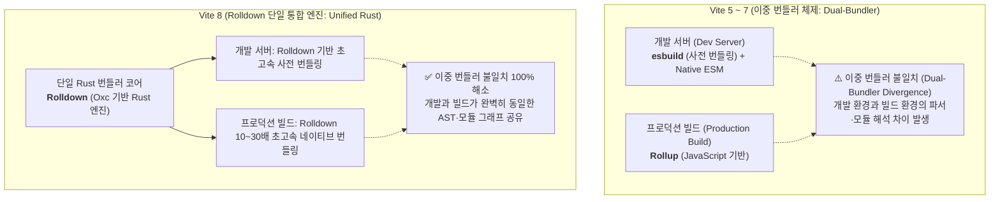
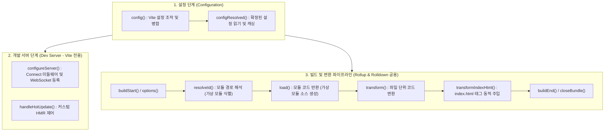

> Vite의 빠른 개발 경험(DX)과 유연한 확장성의 중심에는 체계적인 플러그인 아키텍처가 자리 잡고 있습니다. 특히 최근 프론트엔드 빌드 툴체인은 **Vite 7의 Rollup 기반 과도기**를 지나 **Vite 8에서 Rust 기반 초고속 번들러인 Rolldown으로 단일 통합**되는 거대한 전환기를 맞이하고 있습니다. 본 글에서는 Vite 플러그인의 생명주기 훅(Lifecycle Hooks) 동작 원리를 살펴보고, **Rollup과 Rolldown의 번들러 차이점** 및 가상 모듈·개발 서버 Mock 미들웨어·HTML 변환기 등 실무에 즉시 적용 가능한 3가지 커스텀 플러그인 제작 예제를 소개합니다.

---

## 1. 배경: Vite 번들러의 진화와 커스텀 플러그인의 필요성

현대 웹 애플리케이션의 규모가 비대해지면서 프론트엔드 빌드 도구는 극단적인 성능 최적화와 유연한 확장성을 동시에 요구받고 있습니다.

- **빌드 메타데이터 자동 주입**: 현재 Git 커밋 해시, 빌드 타임스탬프, Node 버전을 런타임 클라이언트 앱에 파일 생성 없이 전달하고 싶은 경우
- **로컬 개발용 무서버 Mocking**: 별도의 모킹 라이브러리(MSW 등)나 로컬 백엔드 서버를 띄우지 않고, Vite 개발 서버 자체에서 특정 API 경로에 대한 JSON 응답을 즉시 반환하고 싶은 경우
- **환경별 HTML 마크업 변환**: 배포 환경(로컬, 스테이징, 프로덕션)에 따라 `index.html`에 Google Analytics 태그, CDN 스크립트, 캐시 무효화 메타 태그를 동적으로 주입하고 싶은 경우

이를 해결하기 위해 Vite 플러그인을 직접 제작하게 되는데, 플러그인을 제대로 설계하려면 먼저 **Vite의 번들러 구조가 어떻게 발전해 왔는지**를 정확히 이해해야 합니다.

---

## 2. Vite 7 vs Vite 8 번들러 진화: Rollup에서 Rust 기반 Rolldown으로

Vite 생태계에서 가장 중대한 아키텍처적 도약은 바로 번들러 코어의 교체입니다.



### 2.1 기존 Vite(Vite 5~7)의 한계: 이중 번들러 불일치 (Dual-Bundler Divergence)

기존 Vite는 로컬 개발 서버의 속도를 위해 Go 언어로 작성된 `esbuild`를 사용해 `node_modules`를 사전 번들링(pre-bundling)하고, 프로덕션 빌드에는 JavaScript로 작성된 `Rollup`을 사용하는 **이중 번들러(Dual-Bundler) 구조**를 채택했습니다.

이 구조는 빠른 개발 서버 기동을 보장했지만 다음과 같은 본질적 한계를 안고 있었습니다:

1. **파서 및 트랜스파일 불일치**: 개발 시 esbuild가 처리하는 문법과 빌드 시 Rollup이 해석하는 AST 간의 미묘한 차이로 인해, "로컬에서는 잘 동작하던 코드가 프로덕션 빌드에서만 깨지는" 에러가 발생했습니다.
2. **Rollup의 성능 병목**: 수만 개 이상의 모듈을 가진 대규모 엔터프라이즈 모노레포에서 JavaScript 싱글스레드 기반의 Rollup은 CPU 바운드 빌드 작업에서 수 분 이상의 긴 시간을 소요했습니다.

### 2.2 Rollup vs Rolldown 심층 비교

Evan You와 VoidZero 팀이 주도하여 개발한 **Rolldown**은 이 문제를 종결짓기 위해 탄생한 Rust 기반의 차세대 번들러입니다.

| 비교 항목 | Rollup (Vite 5~7 기본) | Rolldown (Vite 8 기본 / Vite 7 실험적) |
| :--- | :--- | :--- |
| **구현 언어** | JavaScript (Node.js 런타임) | **Rust** (네이티브 바이너리) |
| **AST / 파서 코어** | Acorn | **Oxc** (초고속 Rust JS/TS 파서 및 맹렬한 컴파일러) |
| **스레딩 모델** | 싱글스레드 이벤트 루프 | **멀티스레드 병렬 처리** (Rayon 기반 모듈 그래프 병렬화) |
| **빌드 성능** | 기준 속도 (1x) | **10배 ~ 30배 이상 향상** |
| **Vite 개발 서버 연동** | 개발(esbuild)과 분리된 빌드 전용 엔진 | 개발 서버(사전 번들링)와 빌드를 **단일 엔진으로 통합** |
| **플러그인 호환성** | 원본 Rollup 플러그인 API 표준 | **Rollup 플러그인 API 100% 드롭인(Drop-in) 호환** |

### 2.3 Vite 7과 Vite 8의 결정적 차이

- **Vite 7 (하이브리드 과도기)**:
  - 프로덕션의 안정성을 위해 여전히 **Rollup이 기본(Default) 번들러**로 동작합니다.
  - Vite 6에서 도입된 `Environment API`(SSR 클라이언트/서버 런타임 분리)를 고도화하면서, Rolldown을 **실험적(opt-in) 엔진**(`build: { rolldown: true }`)으로 제공하여 점진적 마이그레이션과 생태계 플러그인 호환성을 검증하는 다리 역할을 합니다.
- **Vite 8 (Rolldown 단일 통합 시대의 완성)**:
  - **Rolldown이 공식 기본(Default) 번들러로 전면 채택**됩니다.
  - 개발 서버의 esbuild 사전 번들링과 프로덕션의 Rollup이 모두 Rolldown 단일 코어로 통합되어 **이중 번들러 불일치(Dual-Bundler Divergence)가 완전히 종식**됩니다.
  - 개발과 프로덕션이 100% 동일한 AST 및 번들링 규칙을 공유하므로 환경 간 버그가 원천 차단됩니다.

---

## 3. Vite 플러그인의 아키텍처와 생명주기 훅

Vite 플러그인은 Rollup 및 Rolldown의 `Plugin` 인터페이스를 확장한 객체이거나, 해당 객체를 반환하는 팩토리 함수(Factory Function) 형태를 가집니다.

플러그인은 크게 **빌드 공용 훅(Universal Hooks: Rollup/Rolldown 공용)**과 **Vite 전용 훅(Vite-specific Hooks)**으로 나뉩니다.



### 3.1 플러그인의 기본 제어 속성

| 속성명 | 타입 | 설명 |
| :--- | :--- | :--- |
| `name` | `string` | 플러그인의 고유 식별자. 디버깅 및 에러 스택 추적 시 표시되므로 필수 권장됩니다. |
| `enforce` | `'pre' \| 'post'` | 플러그인의 실행 순서를 지정합니다. `'pre'`는 Vite 핵심 플러그인보다 먼저, `'post'`는 번들 후처리 시점에 실행됩니다. |
| `apply` | `'serve' \| 'build' \| Function` | 플러그인이 적용될 환경을 제한합니다. 개발 서버(`serve`) 또는 프로덕션 빌드(`build`) 중 하나만 선택할 수 있습니다. |

### 3.2 Vite 전용 훅 (Vite-specific Hooks)

1. **`config(config, env)`**:
   - 사용자가 작성한 `vite.config.ts` 설정을 사전에 가로채어 부분적으로 수정하거나 기본값을 병합(Merge)합니다.
2. **`configResolved(config)`**:
   - 모든 플러그인의 `config` 훅이 실행되고 최종 설정이 확정된 후 단 한 번 호출됩니다. 다른 훅에서 사용할 설정값을 플러그인 내부 변수에 캐싱해둘 때 유용합니다.
3. **`configureServer(server)`**:
   - 개발 모드(`vite`)에서 구동되는 `ViteDevServer` 인스턴스를 주입받습니다. 내부 Connect 미들웨어(`server.middlewares.use`)에 커스텀 라우트를 추가하거나 WebSocket(`server.ws.send`)으로 클라이언트에 이벤트를 전송할 수 있습니다.
4. **`transformIndexHtml(html, ctx)`**:
   - `index.html` 파일을 서빙하거나 빌드할 때 진입점 HTML을 변환합니다. 태그를 직접 조작하거나 `HtmlTagDescriptor` 구조체를 반환해 `<head>`나 `<body>`에 동적으로 스크립트와 메타 태그를 주입합니다.
5. **`handleHotUpdate(ctx)`**:
   - 파일이 수정되었을 때 발생하는 HMR 이벤트를 직접 핸들링합니다. 특정 파일 변경 시 모듈 그래프 무효화 또는 커스텀 메시지를 브라우저로 발행할 수 있습니다.

### 3.3 Rollup & Rolldown 공용 훅 (Universal Hooks)

Rolldown은 Rollup의 플러그인 사양을 100% 수용하므로, 아래 훅들은 **Vite 7(Rollup)과 Vite 8(Rolldown) 모두에서 코드 수정 없이 동일하게 동작**합니다:

1. **`resolveId(id, importer)`**:
   - 코드 내 `import` 구문에 명시된 경로를 해석합니다. 특히 파일 시스템에 존재하지 않는 **가상 모듈(Virtual Module)**을 선언할 때 필수적으로 사용됩니다.
2. **`load(id)`**:
   - 해석된 모듈 ID에 해당하는 실제 자바스크립트 소스 코드를 생성하여 반환합니다.
3. **`transform(code, id)`**:
   - 특정 확장자나 파일의 소스 코드를 읽어 AST 변환, 매크로 치환, 전처리 등을 수행합니다.

---

## 4. 실무 커스텀 플러그인 제작 예제 3선

플러그인 생명주기 훅의 원리를 바탕으로, Vite 7과 Vite 8에서 모두 완벽하게 동작하는 3가지 실무 예제를 제작해 보겠습니다.

### 예제 1. 가상 모듈 플러그인 (`vite-plugin-build-info`)

어플리케이션 런타임에서 현재 빌드된 Git 커밋 해시, 빌드 일시, 번들러 코어 정보(Rollup 또는 Rolldown)를 확인하고 싶을 때, 디스크에 임시 파일을 쓰지 않고 메모리 상에서 동적 모듈을 제공하는 가상 모듈 플러그인입니다.

```typescript
// plugins/buildInfoPlugin.ts
import type { Plugin } from 'vite';
import { execSync } from 'child_process';

export function buildInfoPlugin(): Plugin {
  const virtualModuleId = 'virtual:build-info';
  const resolvedVirtualModuleId = '\0' + virtualModuleId;

  let commitHash = 'unknown';
  try {
    commitHash = execSync('git rev-parse --short HEAD').toString().trim();
  } catch {
    commitHash = 'dev-workspace';
  }

  return {
    name: 'vite-plugin-build-info',

    // 1. 가상 모듈 ID 해석 (Rollup / Rolldown 공용 훅)
    resolveId(id: string) {
      if (id === virtualModuleId) {
        return resolvedVirtualModuleId;
      }
      return null;
    },

    // 2. 가상 모듈 코드 동적 생성 (Rollup / Rolldown 공용 훅)
    load(id: string) {
      if (id === resolvedVirtualModuleId) {
        const buildData = {
          commitHash,
          buildTime: new Date().toISOString(),
          nodeVersion: process.version,
          bundler: 'rolldown-ready',
          environment: process.env.NODE_ENV || 'development'
        };

        return `export default ${JSON.stringify(buildData, null, 2)};`;
      }
      return null;
    }
  };
}
```

클라이언트 코드에서는 TypeScript 타입 선언 후 마치 일반 패키지처럼 임포트하여 사용할 수 있습니다:

```typescript
// src/vite-env.d.ts
declare module 'virtual:build-info' {
  interface BuildInfo {
    commitHash: string;
    buildTime: string;
    nodeVersion: string;
    bundler: string;
    environment: string;
  }
  const buildInfo: BuildInfo;
  export default buildInfo;
}

// src/main.ts
import buildInfo from 'virtual:build-info';

console.log('App initialized with Build Info:', buildInfo);
```

#### 번들 빌드 및 주입 검증

가상 모듈 플러그인을 적용하고 프로덕션 빌드를 수행한 결과, 파일 시스템에 불필요한 아티팩트를 남기지 않고 클라이언트 번들에 빌드 메타데이터가 내장되는 것을 확인할 수 있습니다.


_virtual:build-info 가상 모듈 빌드 및 주입 검증 화면_

---

### 예제 2. 개발 서버 Mock API 미들웨어 플러그인 (`vite-plugin-mock-dev-server`)

백엔드 API가 배포되기 전 프론트엔드 기능을 로컬에서 검증해야 할 때, 별도의 Node 서버나 추가 도구 없이 Vite 개발 서버의 내장 Connect 미들웨어를 활용해 Mock API 라우트를 등록할 수 있습니다.

```typescript
// plugins/mockDevServerPlugin.ts
import type { Plugin, ViteDevServer } from 'vite';
import type { IncomingMessage, ServerResponse } from 'http';

export function mockDevServerPlugin(): Plugin {
  return {
    name: 'vite-plugin-mock-dev-server',
    // 개발 서버(serve) 모드에서만 동작하도록 제한
    apply: 'serve',

    // Vite 전용 개발 서버 제어 훅
    configureServer(server: ViteDevServer) {
      server.middlewares.use((req: IncomingMessage, res: ServerResponse, next: () => void) => {
        // 1. GET /api/mock/ping 핸들러
        if (req.method === 'GET' && req.url === '/api/mock/ping') {
          res.setHeader('Content-Type', 'application/json');
          res.statusCode = 200;
          res.end(
            JSON.stringify({
              status: 'success',
              message: 'pong',
              source: 'vite-plugin-mock-dev-server',
              serverTime: new Date().toISOString()
            })
          );
          return;
        }

        // 2. POST /api/mock/users 핸들러
        if (req.method === 'POST' && req.url === '/api/mock/users') {
          let body = '';
          req.on('data', (chunk) => {
            body += chunk;
          });
          req.on('end', () => {
            try {
              const parsed = JSON.parse(body || '{}');
              res.setHeader('Content-Type', 'application/json');
              res.statusCode = 200;
              res.end(
                JSON.stringify({
                  code: 200,
                  data: {
                    id: 'usr_99812',
                    name: parsed.name || 'Anonymous',
                    role: parsed.role || 'Member',
                    createdAt: new Date().toISOString()
                  }
                })
              );
            } catch {
              res.statusCode = 400;
              res.end(JSON.stringify({ error: 'Invalid JSON payload' }));
            }
          });
          return;
        }

        // 일치하는 mock 라우트가 없으면 다음 Vite 미들웨어로 위임
        next();
      });
    }
  };
}
```

#### 개발 서버 Mock API 응답 검증

Vite 개발 서버를 기동한 후 `curl`을 통해 미들웨어에 등록된 엔드포인트를 호출하면 백엔드 서버 없이도 즉시 규격화된 Mock JSON 응답이 반환됩니다.


_Vite Connect 미들웨어 기반 Mock API 호출 결과 화면_

---

### 예제 3. 배포 환경별 HTML 태그 주입 플러그인 (`vite-plugin-html-env-inject`)

배포 환경에 따라 `index.html`에 Google Analytics 추적 스크립트나 빌드 버전 메타 태그를 동적으로 주입해야 할 때 사용하는 HTML 변환 플러그인입니다.

```typescript
// plugins/htmlEnvInjectPlugin.ts
import type { Plugin, HtmlTagDescriptor } from 'vite';

interface HtmlEnvInjectOptions {
  gaMeasurementId?: string;
  appVersion?: string;
}

export function htmlEnvInjectPlugin(options: HtmlEnvInjectOptions = {}): Plugin {
  let isProduction = false;

  return {
    name: 'vite-plugin-html-env-inject',

    // Vite 설정 확정 훅: 실행 환경 확인
    configResolved(config) {
      isProduction = config.command === 'build' && config.mode === 'production';
    },

    // Vite 전용 HTML 변환 훅
    transformIndexHtml(html: string) {
      const tags: HtmlTagDescriptor[] = [];

      // 1. 기본 빌드 메타 태그 주입
      tags.push(
        {
          tag: 'meta',
          attrs: { name: 'build-version', content: options.appVersion || 'v1.0.0' },
          injectTo: 'head'
        },
        {
          tag: 'meta',
          attrs: { name: 'build-environment', content: isProduction ? 'production' : 'development' },
          injectTo: 'head'
        }
      );

      // 2. 프로덕션 환경에서만 Google Analytics 스크립트 주입
      if (isProduction && options.gaMeasurementId) {
        tags.push(
          {
            tag: 'script',
            attrs: {
              async: true,
              src: `https://www.googletagmanager.com/gtag/js?id=${options.gaMeasurementId}`
            },
            injectTo: 'head'
          },
          {
            tag: 'script',
            children: `
              window.dataLayer = window.dataLayer || [];
              function gtag(){dataLayer.push(arguments);}
              gtag('js', new Date());
              gtag('config', '${options.gaMeasurementId}');
            `,
            injectTo: 'head'
          }
        );
      }

      return {
        html,
        tags
      };
    }
  };
}
```

`vite.config.ts`에서 다음과 같이 플러그인을 등록합니다:

```typescript
// vite.config.ts
import { defineConfig } from 'vite';
import { buildInfoPlugin } from './plugins/buildInfoPlugin';
import { mockDevServerPlugin } from './plugins/mockDevServerPlugin';
import { htmlEnvInjectPlugin } from './plugins/htmlEnvInjectPlugin';

export default defineConfig({
  plugins: [
    buildInfoPlugin(),
    mockDevServerPlugin(),
    htmlEnvInjectPlugin({
      gaMeasurementId: 'G-XXXXXXX',
      appVersion: 'v1.4.2'
    })
  ]
});
```

#### dist/index.html 동적 주입 결과 검증

빌드 완료 후 생성된 `dist/index.html` 파일을 열어보면, 메타 태그와 구글 태그 매니저 스크립트가 `<head>` 영역에 순서대로 자동 주입되어 있는 것을 확인할 수 있습니다.


_dist/index.html 동적 주입 메타 태그 및 GA 스크립트 검증 화면_

---

## 5. Vite 플러그인 제작 시 모범 사례와 Rolldown 마이그레이션 주의사항

커스텀 플러그인을 실무 프로젝트에 도입할 때는 다음과 같은 설계 원칙을 준수해야 Vite 7(Rollup)과 Vite 8(Rolldown) 양쪽 환경에서 모두 견고하게 동작합니다.

### 5.1 가상 모듈의 Null 바이트(`\0`) 접두사 컨벤션
Rollup 및 Rolldown 생태계에서 가상 모듈을 생성할 때는 모듈 식별자 앞에 Null 바이트(`\0`)를 붙이는 것이 공식 표준입니다. 이는 번들러 내부의 파일 시스템 탐색기가 해당 식별자를 디스크의 실제 파일 경로로 오인하여 I/O를 시도하는 문제를 방지합니다.

### 5.2 Rolldown 환경에서의 훅 오버헤드 최소화
Vite 8의 Rolldown 엔진은 Rust 네이티브 멀티스레드로 동작합니다. 만약 JavaScript 기반 플러그인의 `transform` 훅에서 무거운 연산을 매 파일마다 수행하면, Rust와 Node.js 간의 FFI(Foreign Function Interface) 경계를 넘나드는 IPC 오버헤드가 발생할 수 있습니다. 따라서 정규식이나 파일 확장자 필터(`include`/`exclude`)를 사전에 엄격히 적용하여 필요한 대상 파일에만 훅이 실행되도록 제한해야 합니다.

### 5.3 `apply` 속성을 통한 개발/빌드 환경 분리
개발 서버에서만 사용되는 모킹이나 디버깅 플러그인이 프로덕션 번들에 포함되거나 불필요한 빌드 오버헤드를 발생시키지 않도록 `apply: 'serve'` 또는 `apply: 'build'`를 반드시 지정하는 것이 좋습니다.

---

## 6. 마치며

Vite 플러그인은 복잡한 번들러 내부를 직접 건드리지 않고도 Rollup/Rolldown 호환 훅과 Vite 전용 훅의 조화를 통해 프론트엔드 개발 경험(DX)과 빌드 파이프라인을 획기적으로 개선할 수 있는 강력한 도구입니다.

특히 **Vite 7의 과도기 지원을 거쳐 Vite 8에서 Rolldown 단일 통합 번들러로 진화**함에 따라, 개발 환경과 프로덕션 빌드 간의 불일치가 완전히 해소되고 번들링 속도가 비약적으로 향상되고 있습니다. 프로젝트 내에서 반복되는 빌드 전후 작업이나 개발 서버 연동 작업이 있다면, 미래 Vite 8 Rolldown 생태계까지 내다보는 유연한 커스텀 Vite 플러그인을 직접 구축해 보시기를 권장합니다.


