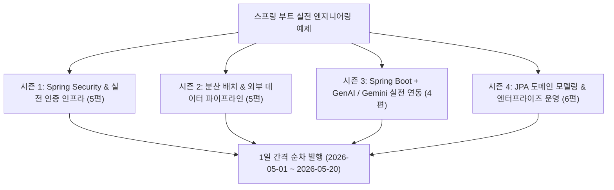

# 📝 스프링 부트 실전 엔지니어링 가이드 연재 계획서 (plan.md)

이 문서는 **남주의 커밋로그([https://namju.kim](https://namju.kim))**에서 스프링 부트(Spring Boot) 실무 백엔드를 구축하며 직면하는 핵심 아키텍처와 트러블슈팅을 체계적으로 연재하기 위한 **스프링 부트 실전 엔지니어링 가이드 (20대 완성형 예제 연재 계획서)**입니다.

---

## 1. 연재 개요 및 로드맵 구조

- **기술 스택**: Kotlin 2.3, Java 25, Spring Boot 4.1, PostgreSQL 17, Redis 7, Spring AI/Gemini
- **카테고리**: `[Spring, Feature]` (AI 관련 편은 `[Spring-AI]`)
- **글쓰기 스타일**: [`writing-tone.md`](file:///Users/kimnamju/Documents/GitHub/blog/writing-tone.md) 스타일 1(문제 해결/트러블슈팅형) 및 스타일 2(Quick Start/튜토리얼형)
- **분량**: 포스트당 5분 읽기 분량 (1,500 ~ 2,500자 내외)
- **시각 자료**: 포스트당 실제 터미널/실행 화면 최소 2~3장 필수 배치 (`assets/images/YYYY-MM-DD/`, 여백 없이 타이트 크롭, 코드 캡처 금지)
- **코드 원칙**: Kotlin First, 복붙 가능한 완성도 높은 코드(주요 import/어노테이션/경로 주석 명시)
- **발행 일정**: `2026-05-01`부터 **1일 간격** 순차 발행 (`2026-05-01` ~ `2026-05-20`)



---

## 2. 시즌 1: Spring Security & 실전 인증 인프라 (우선 연재)

### 📄 포스트 1: 단일 스프링 부트에서 API(JWT)와 관리자 Web(세션) 멀티 SecurityFilterChain 정석 분리
- **파일명**: `_posts/Spring/Feature/2026-05-01-spring-security-multi-filter-chain-jwt-session.md`
- **발행일**: `2026-05-01 12:00:00 +0900`
- **제목**: `단일 스프링 부트에서 API(JWT Stateless)와 관리자 Web(세션 FormLogin) 멀티 SecurityFilterChain 정석 구성하기`
- **카테고리**: `[Spring, Feature]`
- **태그**: `[spring-boot, spring-security, kotlin, jwt, session, security-filter-chain]`
- **주요 레퍼런스**: Spring Boot 공식 레퍼런스 및 실무 아키텍처 예제
- **이미지 폴더**: `assets/images/2026-05-01/`
- **필수 스크린샷 (3장)**:
  1. Swagger UI에서 Bearer JWT 헤더로 `/api/v1/...` 200 OK 호출 결과
  2. 브라우저에서 `/admin/login` 접속 시 세션 쿠키 기반 로그인 성공 화면
  3. API 체인 미인증 시 JSON 형태의 401 Unauthorized 에러 응답
- **목차 구성**:
  1. **서두 요약**: 한 앱에서 모바일/SPA용 REST API와 사내용 관리자 대시보드를 공존시킬 때 생기는 인증 충돌
  2. **아키텍처 설계**: `@Order`와 `securityMatcher`로 분리하는 3대 보안 체인 (API 체인, Admin 체인, Fallback 체인)
  3. **API 보안 체인 구현**: `BearerTokenAuthenticationFilter` + `NullSecurityContextRepository`를 활용한 완전 무상태 구성
  4. **관리자 보안 체인 구현**: 세션 활성화, CSRF 보호, 커스텀 `FormLogin` 핸들러
  5. **인증 실패/인가 거부 핸들러**: JSON 반환 vs 로그인 페이지 리다이렉트 분기 처리
  6. **동작 검증 및 테스트**: `MockMvc`로 두 체인의 독립적 동작 검증

---

### 📄 포스트 2: Refresh Token Rotation(RTR) 동시성 경합과 토큰 재사용 감지(Theft Detection)
- **파일명**: `_posts/Spring/Feature/2026-05-02-jwt-refresh-token-rotation-race-condition.md`
- **발행일**: `2026-05-02 12:00:00 +0900`
- **제목**: `Refresh Token Rotation(RTR) 도입 시 동시 요청 경합(Race Condition)과 토큰 탈취 방지 대응기`
- **카테고리**: `[Spring, Feature]`
- **태그**: `[spring-boot, spring-security, jwt, refresh-token, redis, concurrency]`
- **주요 레퍼런스**: Spring Boot 공식 레퍼런스 및 실무 아키텍처 예제
- **이미지 폴더**: `assets/images/2026-05-02/`
- **필수 스크린샷 (3장)**:
  1. Redis CLI에서 리프레시 토큰 키와 메타데이터 저장 상태 확인 화면
  2. 동시 갱신 요청 시 원자적 토큰 소비 및 락 처리 로그 콘솔
  3. 이미 사용된 토큰 재전송 시 `AUTH-006` 에러와 함께 모든 기기 토큰 무효화 응답 화면
- **목차 구성**:
  1. **서두 요약**: RTR 패턴의 필요성과 프론트엔드 다중 탭 동시 갱신 요청 시 발생하는 원자성 깨짐 문제
  2. **문제 상황**: 토큰 갱신 도중 네트워크 지연이나 동시 호출로 유효한 토큰이 거부되는 현상
  3. **해결 설계 1**: Redis를 활용한 리프레시 토큰의 원자적 소비(Atomic Consume)와 유예 기간 처리
  4. **해결 설계 2**: 토큰 재사용 감지(Reuse Detection) 시 해당 유저의 모든 토큰 패밀리 즉시 강제 폐기
  5. **프론트엔드 연동 가이드**: 401 수신 시 단일 갱신 큐(Mutex/BroadcastChannel) 처리 패턴
  6. **결과 검증**: 동시 요청 스레드 테스트 코드로 안전성 입증

---

### 📄 포스트 3: 무상태(Stateless) JWT 환경에서 전체 로그아웃 & 회원 탈퇴 시 액세스 토큰 즉시 무효화
- **파일명**: `_posts/Spring/Feature/2026-05-03-stateless-jwt-instant-revocation-redis.md`
- **발행일**: `2026-05-03 12:00:00 +0900`
- **제목**: `무상태(Stateless) JWT의 한계 넘기: 전체 로그아웃과 탈퇴 시 액세스 토큰 즉시 무효화하는 전략`
- **카테고리**: `[Spring, Feature]`
- **태그**: `[spring-boot, spring-security, jwt, redis, token-revocation]`
- **주요 레퍼런스**: Spring Boot 공식 레퍼런스 및 실무 아키텍처 예제
- **이미지 폴더**: `assets/images/2026-05-03/`
- **필수 스크린샷 (3장)**:
  1. 전체 로그아웃(`POST /api/v1/auth/logout-all`) 성공 응답 화면
  2. 기존에 발급받은 유효한 Bearer 토큰으로 재호출 시 401 `AUTH-008` 거부 화면
  3. Redis에 저장된 유저별 무효화 타임스탬프(`invalidatedBefore`) 확인 화면
- **목차 구성**:
  1. **서두 요약**: 무상태 JWT의 최대 단점: "사용자가 로그아웃하거나 탈퇴해도 토큰 만료 전까지는 유효하다"
  2. **기술적 선택지 비교**: 모든 토큰의 JTI 블랙리스트 저장 vs 유저별 무효화 기준 시각(Timestamp) 대조
  3. **설계 및 구현**: Redis에 `user:invalidated_before:{userId}` 기록 및 JWT 파싱 필터에서 시간 비교
  4. **개별 기기 로그아웃 vs 전체 기기 로그아웃**의 트레이드오프 처리
  5. **성능 최적화**: 매 요청마다 Redis 조회를 수행할 때의 캐싱 및 부하 방지 전략
  6. **결과 확인**: Postman/curl을 통한 즉시 무효화 시나리오 검증

---

### 📄 포스트 4: 1:N 다중 소셜 계정 연동 모델링과 사용자/관리자 로그인 진입점 분리
- **파일명**: `_posts/Spring/Feature/2026-05-04-multi-social-login-account-linking.md`
- **발행일**: `2026-05-04 12:00:00 +0900`
- **제목**: `카카오·구글·네이버 다중 소셜 계정 연동(1:N) 모델링과 사용자/관리자 로그인 진입점 분리`
- **카테고리**: `[Spring, Feature]`
- **태그**: `[spring-boot, oauth2, social-login, jpa, kotlin]`
- **주요 레퍼런스**: Spring Boot 공식 레퍼런스 및 실무 아키텍처 예제
- **이미지 폴더**: `assets/images/2026-05-04/`
- **필수 스크린샷 (3장)**:
  1. 유저 상세 화면에서 연결된 다중 소셜 계정(카카오, 네이버) 목록 표시 화면
  2. 소셜 인가 코드를 통한 토큰 교환 API 응답 화면
  3. 일반 유저와 관리자 소셜 로그인 분기 처리 흐름도
- **목차 구성**:
  1. **서두 요약**: 이메일 가입 유저가 카카오, 구글, 네이버 소셜 계정을 자유롭게 연결하고 해제할 수 있는 유연한 구조 설계
  2. **엔티티 모델링**: `User`와 `SocialAccount`를 1:N으로 분리하고 복합 유니크 제약(`provider`, `providerUserId`) 부여
  3. **소셜 로그인 프로세스**: Authorization Code 수신 ➔ Access Token 발급 ➔ 프로필 조회 ➔ 계정 자동 가입/연결
  4. **관리자 vs 일반 유저 진입점 분리**: 같은 소셜 로그인이라도 관리자 페이지 접근 권한 격리
  5. **회원 탈퇴 시 Cascade 정책**: 소셜 연결 정보 삭제 및 기존 작성 데이터의 보존 처리
  6. **결과 검증**: 다중 소셜 계정 연동 시나리오 테스트

---

## 3. 시즌 2: 분산 배치 & 외부 데이터 파이프라인

### 📄 포스트 5: Spring Batch 없이 만드는 Redis ShedLock + DB 리스 기반 경량 분산 작업 실행기(Job Runner)
- **파일명**: `_posts/Spring/Feature/2026-05-05-lightweight-distributed-job-runner-shedlock.md`
- **발행일**: `2026-05-05 12:00:00 +0900`
- **제목**: `Spring Batch 없이 만드는 Redis ShedLock + DB 리스 기반의 경량 분산 작업 실행기(Job Runner)`
- **카테고리**: `[Spring, Feature]`
- **태그**: `[spring-boot, redis, shedlock, batch, distributed-lock, kotlin]`
- **주요 레퍼런스**: Spring Boot 공식 레퍼런스 및 실무 아키텍처 예제
- **이미지 폴더**: `assets/images/2026-05-05/`
- **필수 스크린샷 (3장)**:
  1. `/admin/jobs` 관리자 작업 현황 대시보드 화면
  2. 다중 인스턴스 환경에서 분산 락 획득 실패 시 안전하게 스킵되는 로그 화면
  3. 실행 이력 테이블(`job_runs`)에 상태, 진행률, 처리 건수가 기록된 화면
- **목차 구성**:
  1. **서두 요약**: 가벼운 배치/수집 작업에 Spring Batch 도입이 부담스러울 때 취할 수 있는 실용적 대안
  2. **핵심 아키텍처**: Redis ShedLock(초기 락) + DB Lease(심장박동 연장) 이중 안전장치
  3. **JobDefinition & JobRunner 구조**: 작업 인터페이스 정의 및 동적 등록
  4. **스케줄러와 수동 실행 제어**: cron 동적 변경, 안전한 작업 중단(CANCELLED)
  5. **진행률 및 실패 이력 관리**: `JobRun` 엔티티를 통한 실시간 모니터링
  6. **결과 검증**: 동시 다중 실행 방지 및 리스 만료 복구 통합 테스트

---

### 📄 포스트 6: 대규모 배치 작업의 중단과 이어 달리기: JSON 체크포인트 상태 머신
- **파일명**: `_posts/Spring/Feature/2026-05-06-batch-checkpoint-resume-pattern.md`
- **발행일**: `2026-05-06 12:00:00 +0900`
- **제목**: `대규모 배치 작업의 중단과 이어 달리기: JSON 체크포인트 상태 머신과 트랜잭션 롤백 격리`
- **카테고리**: `[Spring, Feature]`
- **태그**: `[spring-boot, batch, checkpoint, transaction, postgresql]`
- **주요 레퍼런스**: Spring Boot 공식 레퍼런스 및 실무 아키텍처 예제
- **이미지 폴더**: `assets/images/2026-05-06/`
- **필수 스크린샷 (3장)**:
  1. 수집 작업 중단 후 관리자에서 [이어 실행 (RESUME)] 클릭 화면
  2. DB에 저장된 JSON 체크포인트(`lastPage`, `remainingSerials`, `done`) 조회 화면
  3. 특정 항목 실패 시 해당 항목만 롤백되고 전체 배치는 안전하게 진행되는 로그
- **목차 구성**:
  1. **서두 요약**: 수만 건의 외부 데이터를 수집할 때 네트워크 중단이나 배포가 발생해도 처음부터 다시 시작하지 않는 비결
  2. **체크포인트(Checkpoint) 설계**: 가벼운 JSON 스키마로 저장하는 배치 상태 커서
  3. **원자적 커밋과 항목 격리**: `context.process(itemKey, checkpoint)` 안에서 비즈니스 로직과 체크포인트 동시 커밋
  4. **장애 처리와 상태 전이**: FAILED 정리, RESUME(이어 실행), RESTART(초기화 실행)의 상태 머신
  5. **지연된 응답 방어**: 리스가 만료된 이전 프로세스의 체크포인트 덮어쓰기 방지
  6. **결과 확인**: 모의 네트워크 단절 상황에서의 자동 복구 테스트

---

### 📄 포스트 7: 공공 데이터 포털 Open API 연동의 정석: Redis 분산 Rate Limiter와 429 지수 백오프
- **파일명**: `_posts/Spring/Feature/2026-05-07-open-api-distributed-rate-limiter-backoff.md`
- **발행일**: `2026-05-07 12:00:00 +0900`
- **제목**: `공공 데이터 포털 Open API 연동의 정석: Redis 분산 Rate Limiter, 429 지수 백오프, 보안 마스킹`
- **카테고리**: `[Spring, Feature]`
- **태그**: `[spring-boot, open-api, rate-limiting, redis, rest-client, kotlin]`
- **주요 레퍼런스**: Spring Boot 공식 레퍼런스 및 실무 아키텍처 예제
- **이미지 폴더**: `assets/images/2026-05-07/`
- **필수 스크린샷 (3장)**:
  1. Redis 글로벌 호출 게이트(`LawApiRequestGate`) 동작 로그 (정확히 1초 간격 호출 유지)
  2. 429 Too Many Requests 수신 시 Retry-After 기반 지수 백오프 대기 로그
  3. 외부 에러 로그에서 민감 API 키(`OC`)가 마스킹된 보안 로그 화면
- **목차 구성**:
  1. **서두 요약**: 까다로운 호출 제한(초당 1회, 쿼터 제한)과 툭하면 에러를 뱉는 공공 API를 안정적으로 품어내는 법
  2. **다중 인스턴스 호출 간격 제어**: Redis 키를 이용한 인스턴스 간 1초 시작 간격 게이트 구현
  3. **지수 백오프와 Retry-After**: 일시적 5xx 및 429 응답 발생 시 스마트 재시도 전략
  4. **비정상 응답 방어**: HTML 응답, 일련번호 불일치, 쿼터 초과 시 빠른 실패(Fail-Fast)
  5. **보안 감사**: URL 쿼리 파라미터에 포함된 API 인증키가 로그에 노출되지 않도록 마스킹 처리
  6. **결과 확인**: MockWebServer를 활용한 에러/지연 상황 시뮬레이션

---

### 📄 포스트 8: 외부 데이터 수집의 정석: Raw 데이터 불변 보존과 무중단 재파싱(Reparse) 아키텍처
- **파일명**: `_posts/Spring/Feature/2026-05-08-raw-data-immutability-and-reparsing.md`
- **발행일**: `2026-05-08 12:00:00 +0900`
- **제목**: `외부 데이터 수집 파이프라인 설계: 원문(Raw Data) 불변 보존과 무중단 재파싱(Reparse) 아키텍처`
- **카테고리**: `[Spring, Feature]`
- **태그**: `[spring-boot, jpa, data-pipeline, parsing, postgresql]`
- **주요 레퍼런스**: Spring Boot 공식 레퍼런스 및 실무 아키텍처 예제
- **이미지 폴더**: `assets/images/2026-05-08/`
- **필수 스크린샷 (3장)**:
  1. 관리자 화면에서 '수집 응답 원문 JSON' 상세 뷰어 화면
  2. 파서 버전 업데이트 후 외부 호출 없이 로컬 DB에서 수만 건 재파싱되는 배치 실행 화면
  3. 파싱 실패 시 원문은 보존되고 실패 사유가 기록된 보류 목록 화면
- **목차 구성**:
  1. **서두 요약**: 외부 API 응답을 바로 도메인 엔티티에 매핑했다가 파서 버그나 요구사항 변경으로 후회했던 경험
  2. **원문 테이블(`raw_judgments`) 분리**: 수집 시점의 원본 JSON을 그대로 보존하는 불변 아카이브 전략
  3. **버전 관리형 파서(`JudgmentParser`)**: `parserVersion`과 `parsedAt` 메타데이터 도입
  4. **무중단 재파싱 배치**: 외부 API 쿼터를 소모하지 않고 로컬 DB 원문으로 도메인 모델을 일괄 갱신하는 기법
  5. **동명이인 및 데이터 모호성 방어**: 서명부 판사 매칭 보류 및 관리자 검토 플래그(`judgeReviewRequired`)
  6. **결과 확인**: 파서 규칙 수정 후 재파싱 실행 결과 비교

---

## 4. 시즌 3: Spring Boot + GenAI / Gemini 실전 연동

### 📄 포스트 9: Spring AI 대신 Google GenAI SDK를 쓴 이유: Google Search Grounding 메타데이터 보존
- **파일명**: `_posts/Spring/AI/2026-05-09-spring-ai-vs-google-genai-sdk-grounding.md`
- **발행일**: `2026-05-09 12:00:00 +0900`
- **제목**: `Spring AI 대신 Google GenAI SDK를 직접 쓴 이유: Google Search Grounding 메타데이터 보존하기`
- **카테고리**: `[Spring, AI]`
- **태그**: `[spring-boot, spring-ai, gemini, google-genai, search-grounding, kotlin]`
- **주요 레퍼런스**: Spring Boot 공식 레퍼런스 및 실무 아키텍처 예제
- **이미지 폴더**: `assets/images/2026-05-09/`
- **필수 스크린샷 (3장)**:
  1. Gemini Google Search 도구 호출 시 반환되는 grounding 메타데이터(출처 URL, 검색어) 디버그 덤프
  2. `gemini-3.5-flash-lite` 모델의 호출당 토큰 소모량 및 비용 측정 대시보드
  3. 관리자 화면에 노출된 기사 도메인별 출처 칩 UI 화면
- **목차 구성**:
  1. **서두 요약**: LLM에 실시간 웹 검색(Google Search)을 붙여 최신 뉴스를 가져오는 파이프라인 구축기
  2. **트러블슈팅: Spring AI 2.0.1의 한계**: ChatResponse 변환 과정에서 grounding 메타데이터가 누락되는 문제 발견
  3. **해결책**: Kotlin 환경에서 Google GenAI SDK 직결 연동 및 검색 도구 활성화
  4. **모델 최적화**: 고비용 모델 대신 `gemini-3.5-flash-lite`를 선택해 토큰 비용 80% 절감한 경험
  5. **비용 및 할당량 안전장치**: 호출 이력 테이블(`judgment_discovery_calls`)과 일일 호출 한도 제어
  6. **결과 확인**: 실제 검색 쿼리 실행 및 출처 메타데이터 추출 검증

---

### 📄 포스트 10: LLM 환각(Hallucination) 잡는 2단계 검증: 뉴스 기사 추출과 공공 API 교차 대조
- **파일명**: `_posts/Spring/AI/2026-05-10-llm-hallucination-ground-truth-verification.md`
- **발행일**: `2026-05-10 12:00:00 +0900`
- **제목**: `LLM 환각(Hallucination) 잡는 2단계 검증: 뉴스 기사 탐색과 공공 Open API 실시간 교차 대조`
- **카테고리**: `[Spring, AI]`
- **태그**: `[spring-boot, gemini, hallucination, open-api, data-verification]`
- **주요 레퍼런스**: Spring Boot 공식 레퍼런스 및 실무 아키텍처 예제
- **이미지 폴더**: `assets/images/2026-05-10/`
- **필수 스크린샷 (3장)**:
  1. 관리자 판결 후보 목록에서 '원문 대기' ➔ '원문 확인(VERIFIED)'으로 상태 전이된 화면
  2. LLM이 생성한 법원 약칭('서울고법 형사1부')이 서버 규칙을 통해 '서울고등법원'으로 정규화되는 로그
  3. 관리자 상세 화면에서 뉴스 기사 원문과 공공 API 원문이 나란히 대조된 화면
- **목차 구성**:
  1. **서두 요약**: "LLM이 찾았으니 맞겠지?"라는 착각을 깨부수는 Ground Truth 검증 아키텍처
  2. **1단계: LLM 추출 단계의 안전장치**: 출처 목록에 없는 환각 기사 필터링 및 사건번호 정규식 검증
  3. **서버 사이드 정규화**: 언론사/LLM이 제각각 쓰는 법원 약칭을 법원조직법상 공식 명칭으로 매핑
  4. **2단계: 국가법령정보센터 실시간 교차 대조**: 사건번호, 법원명, 선고일 3개 키의 완벽 일치 판정
  5. **휴먼 인 더 루프(HITL)**: 애매한 후보를 관리자가 직접 확인하고 승인/반려하는 안전망
  6. **결과 확인**: 환각 케이스와 정상 케이스의 필터링 테스트

---

## 5. 시즌 4: JPA 도메인 모델링 & 엔터프라이즈 운영

### 📄 포스트 11: JPA 엔티티 PK로 왜 UUIDv7을 선택했는가?
- **파일명**: `_posts/Spring/Feature/2026-05-11-why-uuidv7-for-jpa-entity-pk.md`
- **발행일**: `2026-05-11 12:00:00 +0900`
- **제목**: `JPA 엔티티 PK로 왜 UUIDv7을 선택했는가? (UUIDv4의 B-Tree 인덱스 파편화 극복과 시간 순 정렬)`
- **카테고리**: `[Spring, Feature]`
- **태그**: `[spring-boot, jpa, postgresql, uuidv7, database-indexing]`
- **주요 레퍼런스**: Spring Boot 공식 레퍼런스 및 실무 아키텍처 예제
- **이미지 폴더**: `assets/images/2026-05-11/`
- **필수 스크린샷 (3장)**:
  1. UUIDv4 vs UUIDv7 인덱스 생성 및 대량 삽입 시 디스크 쓰기 성능 비교 그래프
  2. PostgreSQL 17에서 생성된 UUIDv7 컬럼 데이터 조회 화면
  3. Kotlin에서 UUIDv7 생성기를 공통 IdGenerator로 등록한 코드 구조
- **목차 구성**:
  1. **서두 요약**: Auto Increment의 분산 환경 채번 충돌과 UUIDv4의 인덱스 파편화(B-Tree Fragmentation) 딜레마
  2. **UUIDv7의 등장 배경**: 시간(Timestamp) 접두사가 포함되어 순차 삽입이 가능한 차세대 식별자
  3. **Kotlin + Spring Data JPA 연동**: Hibernate 6.x / 7.x에서의 UUIDv7 매핑 방법
  4. **성능 벤치마크**: 100만 건 INSERT 시 B-Tree 리밸런싱 비용 및 인덱스 크기 비교
  5. **보안적 이점**: Auto Increment 예측 공격 방지와 분산 샤딩 환경 대비
  6. **정리**: 새로운 백엔드 프로젝트를 시작할 때 추천하는 기본 PK 전략

---

### 📄 포스트 12: JPA @Version 낙관적 락으로 관리자 화면의 덮어쓰기(Lost Update) 방지하기
- **파일명**: `_posts/Spring/Feature/2026-05-12-jpa-optimistic-locking-version-lost-update.md`
- **발행일**: `2026-05-12 12:00:00 +0900`
- **제목**: `JPA @Version 낙관적 락(Optimistic Lock)으로 관리자 화면의 덮어쓰기(Lost Update) 방지하기`
- **카테고리**: `[Spring, Feature]`
- **태그**: `[spring-boot, jpa, concurrency, optimistic-lock, thymeleaf]`
- **주요 레퍼런스**: Spring Boot 공식 레퍼런스 및 실무 아키텍처 예제
- **이미지 폴더**: `assets/images/2026-05-12/`
- **필수 스크린샷 (3장)**:
  1. 두 관리자가 동일 게시글 수정 폼을 열고 늦게 저장한 쪽에서 "다른 관리자에 의해 변경되었습니다" 충돌 알림 노출 화면
  2. DB 테이블의 `version` 컬럼 증가 확인 화면
  3. `OptimisticLockingFailureException` 발생 시 HTTP 409 및 안내 화면으로 매핑되는 핸들러 로그
- **목차 구성**:
  1. **서두 요약**: 어드민 화면에서 여러 운영자가 같은 데이터를 동시에 수정할 때 뒤늦은 저장이 앞선 저장을 날려버리는 문제
  2. **비관적 락 vs 낙관적 락**: 조회 빈도가 높고 충돌 빈도가 낮은 어드민 환경에서 낙관적 락이 정답인 이유
  3. **BaseEntity에 `@Version` 적용하기**: Kotlin에서의 `val version: Long = 0` 프로퍼티 정의
  4. **Thymeleaf 폼 연동**: 히든 필드(`<input type="hidden" name="version"...>`) 바인딩
  5. **충돌 처리 UX**: 예외 발생 시 에러 페이지 대신 최신 수정자와 내용을 안내하고 재시도를 유도하는 흐름
  6. **결과 검증**: 동시 수정 충돌 시나리오 단위/통합 테스트 작성

---

### 📄 포스트 13: JPA BaseEntity 소프트 삭제와 유니크 인덱스 충돌 방지 및 휴지통 패턴
- **파일명**: `_posts/Spring/Feature/2026-05-13-jpa-soft-delete-unique-index-conflict-trash-bin.md`
- **발행일**: `2026-05-13 12:00:00 +0900`
- **제목**: `JPA BaseEntity 소프트 삭제(Soft Delete) 시 복합 Unique 제약 충돌 방지와 관리자 휴지통(Trash) 패턴`
- **카테고리**: `[Spring, Feature]`
- **태그**: `[spring-boot, jpa, soft-delete, unique-constraint, postgresql]`
- **주요 레퍼런스**: Spring Boot 공식 레퍼런스 및 실무 아키텍처 예제
- **이미지 폴더**: `assets/images/2026-05-13/`
- **필수 스크린샷 (3장)**:
  1. `/admin/trash` 관리자 휴지통 화면 (삭제된 항목 보기 및 [복구] 버튼)
  2. 회원 탈퇴 후 동일 이메일로 재가입 시 유니크 제약 충돌이 나지 않는 테스트 통과 화면
  3. 우클릭 컨텍스트 메뉴에서 [삭제] 및 [휴지통으로 이동] UI 화면
- **목차 구성**:
  1. **서두 요약**: 데이터를 완전히 삭제(Hard Delete)하지 않고 `deleted = true`로 남길 때 터지는 복합 Unique Key 충돌
  2. **문제 분석**: 탈퇴한 회원의 이메일이나 삭제된 판례 번호 때문에 신규 데이터 저장이 409 충돌로 막히는 원인
  3. **해결 전략**: 부분 인덱스(Partial Unique Index, `WHERE deleted_at IS NULL`) 활용법
  4. **BaseEntity 설계**: `deletedAt`, `deletedBy` 필드와 Hibernate `@SQLRestriction` 적용
  5. **휴지통과 복구 기능**: 삭제된 항목만 모아보는 관리자 탭과 연관 엔티티의 안전한 복구 로직
  6. **결과 확인**: 소프트 삭제 및 롤백/복구 테스트 코드 검증

---

### 📄 포스트 14: 웹 요청 밖(배치·비동기 스레드)에서 JPA Auditing(@CreatedBy) NPE 해결하기
- **파일명**: `_posts/Spring/Feature/2026-05-14-spring-data-jpa-auditor-aware-async-fix.md`
- **발행일**: `2026-05-14 12:00:00 +0900`
- **제목**: `스케줄러와 비동기 배치에서 JPA Auditing(@CreatedBy) 예외 해결하기: AuditorAware 안전화 전략`
- **카테고리**: `[Spring, Feature]`
- **태그**: `[spring-boot, jpa, auditing, async, security-context, kotlin]`
- **주요 레퍼런스**: Spring Boot 공식 레퍼런스 및 실무 아키텍처 예제
- **이미지 폴더**: `assets/images/2026-05-14/`
- **필수 스크린샷 (3장)**:
  1. 웹 요청 밖에서 엔티티 저장 시 발생하던 `NullPointerException` 에러 스택 트레이스
  2. 안전화된 `AuditorAware`가 시스템 기본 식별자(`SYSTEM` 또는 null)를 반환하는 디버그 로그
  3. 백그라운드 수집 배치 작업에서 엔티티가 정상 감사 정보와 함께 저장된 DB 결과 화면
- **목차 구성**:
  1. **서두 요약**: 웹 요청 환경에서는 잘 돌던 코드가 백그라운드 배치 러너에서 실행되자마자 감사 정보 예외로 터지는 이유
  2. **원인 분석**: `SecurityContextHolder`가 비어 있는 비동기 스레드/스케줄러의 컨텍스트 분리 현상
  3. **안전한 AuditorAware 구현**: `Optional.ofNullable`과 인증 객체 타입 체크(`AnonymousAuthenticationToken` 배제)
  4. **시스템 배치용 감사 컨텍스트**: 시스템 실행 시 `JobContext`의 실행자 정보 주입하기
  5. **결과 확인**: 비동기 실행 환경에서의 엔티티 저장 단위 테스트

---

## 6. 전체 20편 연재 로드맵 종합 타임라인

| 주차 | 발행일 | 시즌 | 포스트 제목 |
| :---: | :---: | :---: | :--- |
| **01** | `2026-05-01` | 시즌 1 | **단일 스프링 부트에서 API(JWT)와 관리자 Web(세션) 멀티 SecurityFilterChain 정석 분리** |
| **02** | `2026-05-02` | 시즌 1 | **Refresh Token Rotation(RTR) 도입 시 동시 요청 경합(Race Condition)과 탈취 감지 대응기** |
| **03** | `2026-05-03` | 시즌 1 | **무상태(Stateless) JWT의 한계 넘기: 전체 로그아웃과 탈퇴 시 액세스 토큰 즉시 무효화** |
| **04** | `2026-05-04` | 시즌 1 | **카카오·구글·네이버 다중 소셜 계정 연동(1:N) 모델링과 진입점 분리 전략** |
| **05** | `2026-05-05` | 시즌 2 | **Spring Batch 없이 만드는 Redis ShedLock + DB 리스 기반 경량 분산 작업 실행기** |
| **06** | `2026-05-06` | 시즌 2 | **대규모 배치 작업의 중단과 이어 달리기: JSON 체크포인트 상태 머신과 트랜잭션 롤백 격리** |
| **07** | `2026-05-07` | 시즌 2 | **공공 데이터 포털 Open API 연동의 정석: Redis 분산 Rate Limiter, 429 지수 백오프** |
| **08** | `2026-05-08` | 시즌 2 | **외부 데이터 수집 파이프라인 설계: 원문(Raw Data) 불변 보존과 무중단 재파싱 아키텍처** |
| **09** | `2026-05-09` | 시즌 3 | **Spring AI 대신 Google GenAI SDK를 쓴 이유: Google Search Grounding 메타데이터 보존** |
| **10** | `2026-05-10` | 시즌 3 | **LLM 환각(Hallucination) 잡는 2단계 검증: 뉴스 기사 탐색과 공공 API 실시간 교차 대조** |
| **11** | `2026-05-11` | 시즌 4 | **JPA 엔티티 PK로 왜 UUIDv7을 선택했는가? (B-Tree 인덱스 파편화 극복과 순차 삽입)** |
| **12** | `2026-05-12` | 시즌 4 | **JPA @Version 낙관적 락(Optimistic Lock)으로 관리자 화면의 덮어쓰기(Lost Update) 방지** |
| **13** | `2026-05-13` | 시즌 4 | **JPA BaseEntity 소프트 삭제(Soft Delete) 시 복합 Unique 제약 충돌 방지와 휴지통 패턴** |
| **14** | `2026-05-14` | 시즌 4 | **웹 요청 밖(배치·비동기 스레드)에서 JPA Auditing(@CreatedBy) 예외 해결하기** |
| **15** | `2026-05-15` | 시즌 3 | **Gemini API에서 원하는 DTO 포맷 100% 보장받기: JSON Schema 강제와 비용 최적화** |
| **16** | `2026-05-16` | 시즌 3 | **휴먼 인 더 루프(HITL) 관리자 시스템: AI 탐색 후보의 검토, 식별 정보 보정 및 승인** |
| **17** | `2026-05-17` | 시즌 2 | **공공 데이터 파싱 트러블슈팅: 단기(檀紀) 연호 변환부터 법원 약칭·병합 사건번호 정규화까지** |
| **18** | `2026-05-18` | 시즌 4 | **커뮤니티 인터랙션 설계: 중복 방지와 토글이 가능한 게시글 멀티 반응(Reaction) 시스템** |
| **19** | `2026-05-19` | 시즌 4 | **로컬 개발 생산성(DX) 극대화: Spring Boot Docker Compose 연동과 멱등성 보장 seed 데이터** |
| **20** | `2026-05-20` | 시즌 1 | **Spring Security MockMvc 테스트 완전 정복: JWT 리소스 서버와 세션 체인 각각 검증하기** |

---

## 7. 글 작성 및 품질 검증 수칙 (Agent Rules)

1. **작성 전 필독**: [`writing-tone.md`](file:///Users/kimnamju/Documents/GitHub/blog/writing-tone.md)의 페르소나(김남주)와 어조(~합니다, 단정한 경어체)를 100% 준수합니다.
2. **코드 품질**: 생략 부호(`...`) 남발을 금지하고, 독자가 복사해서 붙여넣었을 때 컴파일이 가능한 수준의 온전한 코드로 작성합니다.
3. **시각 자료**: 실제 실행 결과 화면을 `assets/images/YYYY-MM-DD/`에 배치하고, 여백 없이 타이트 크롭(Tight Crop)하여 모바일에서도 선명하게 보이도록 합니다. 코드는 절대 이미지로 캡처하지 않고 백틱 코드 블록을 사용합니다.
4. **빌드 검증**: 글 작성 완료 후 반드시 아래 명령어로 사이트 빌드와 링크 무결성을 검증합니다:
   ```bash
   bundle exec jekyll build -d /tmp/_site
   bundle exec htmlproofer /tmp/_site --disable-external --ignore-urls "/^http:\/\/127.0.0.1/,/^http:\/\/0.0.0.0/,/^http:\/\/localhost/"
   ```
5. **Git 커밋/푸시 원칙**: AI 에이전트는 절대 직접 `git commit`이나 `git push`를 수행하지 않으며, 작업 완료 후 사용자에게 순수 한글 커밋 명령어를 안내합니다.
